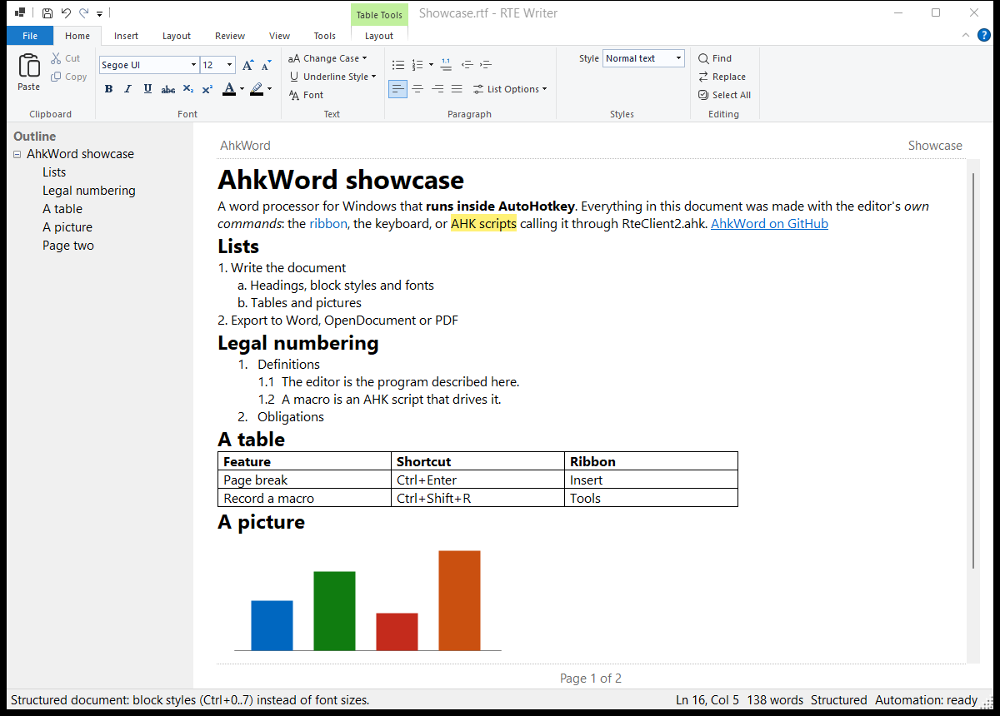

# AhkWord

A word processor for Windows, written in C# and run inside AutoHotkey v2, that AutoHotkey scripts can drive while you type.

AhkWord is built on [RichEditorNET](https://github.com/ellipticbit/RichEditorNET), a .NET wrapper around the Windows RichEdit control, with the Windows Ribbon for its commands. [Csharp-in-AHK](https://github.com/burque505/Csharp-in-AHK) compiles its C# source when it starts and runs it in the AutoHotkey process, so there is no build step and no separate executable.



*[`examples/Showcase.rtf`](examples/Showcase.rtf), made entirely with the editor's own commands.*

> **Work in progress.** The editor is still named **RTE Writer** in the code, its window and its settings folder, and its files are numbered by iteration (`rte_writer17.*`). Renaming them to AhkWord is planned.

## Features

- **Documents:** HTML, Markdown (GitHub flavor, with tables and images), plain text and RTF. Word (`.docx`, `.doc`) and OpenDocument (`.odt`) files are opened and saved through a converter (see [Optional converters](#optional-converters)). Export as PDF through "Microsoft Print to PDF".
- **Formatting:** fonts, colors, highlight, alignment, change case and underline styles. Structured documents use block styles (normal text, headings, preformatted); free-form documents take any font size.
- **Lists:** numbered and bulleted lists nested with Tab and Shift+Tab, a numbering style per level, restart and continue numbering, and legal numbering (1., 1.1, 1.1.1). Typed numbers in documents from elsewhere can be turned into real lists.
- **Tables:** insert tables, add and delete rows and columns, move between cells with Tab and Shift+Tab (Tab in the last cell adds a row, as in Word), also in tables from Word and other programs.
- **Pages:** manual page breaks (Ctrl+Enter), headers and footers with page-number and date fields, Page Setup, Print Preview and printing. Headers and footers are shown in the editor and saved in the document.
- **Pictures:** insert from a file or by drag and drop, resize, and give them alt text (shown when the mouse rests on a picture).
- **Markdown and HTML views:** edit the document as Markdown or HTML, alone or side by side with the formatted text (see [Markdown and HTML views](#markdown-and-html-views)).
- **Writing tools:** spelling suggestions from the Windows spell checker (F7 goes to the next error) and an outline panel of the headings.
- **Comfort:** recent documents and remembered window and page settings. Drop a file on the window to open it.

## The ribbon

The commands are on a ribbon, the one built into Windows (as in Paint and WordPad): it follows the screen's scaling, and works with the keyboard and screen readers.

| Tab | Groups |
|---|---|
| **File** (menu) | New, Open, Save, Save As, Print (with Print Preview and Page Setup), Export (PDF, Word, OpenDocument), Exit, and the recent documents |
| **Home** | Clipboard, Font, Text (change case, underline style, font dialog), Paragraph (lists, levels, alignment, List Options), Styles, Editing (find, replace, select all) |
| **Insert** | Page Break, Table, Picture, Linked Thumbnail, Link, Date & Time |
| **Layout** | Page Setup, Header & Footer, Print Preview |
| **Review** | Next Spelling Error, Add to Dictionary, Check spelling as you type |
| **View** | Document View (Rich Text, Markdown, HTML, Side by Side), Structured or Free-form, Word wrap, Header and footer, Outline, Zoom |
| **Tools** | Macros, Record Macro, Macro Hotkeys, Run Script, Macros Folder, Automation API, About |
| **Table Tools** | Appears while the caret is in a table: insert rows and columns, delete rows, columns or the table |

- **Keyboard:** press **Alt** to see the KeyTips (H Home, N Insert, P Layout, R Review, W View, L Tools, F File). The usual shortcuts work too: Ctrl+B, Ctrl+Shift+N (numbered list), Ctrl+Shift+G (legal numbering), Ctrl+0 to Ctrl+7 (block styles), Ctrl+Enter (page break), F7 (spelling) and more; each button's tooltip shows its shortcut.
- **Numbering:** the arrow next to the Numbering button chooses the numbering style and opens List Levels, where each level's style, punctuation and start number are set. List Options has the rest.
- **Quick access toolbar:** Save, Undo and Redo; its arrow adds New, Open, Print or Print Preview.

## Markdown and HTML views

**View > Document View** shows the document as **Markdown** or **HTML** in a plain-text editor, alone or **Side by Side** with the formatted text, which follows a moment after you stop typing. Edits in the formatted text show in the source too.

- **A Markdown editor:** a `.md` file edited in the Markdown view is saved exactly as you typed it: your spacing, list markers and line endings stay. (Edits made in the formatted view are saved as RTE Writer writes Markdown.)
- **Formatting keys and buttons insert markup:** in the source view, Ctrl+B gives `**bold**` (or `<strong>` in HTML), Ctrl+1 to Ctrl+6 headings, the list buttons `- ` and `1. ` (renumbered as you indent with Ctrl+M), the alignment keys `<div align>`, and the font control `<span style>`; Table, Link, Picture, Page Break and Date & Time insert theirs. Commands with no Markdown or HTML form say so in the status bar.
- **Line breaks** (Shift+Enter) are `<br>` in HTML, and `\` at the line end (or `<br>` in headings and table cells) in Markdown, as other editors write them; both are read back as line breaks.
- **Tables are lined up:** Markdown tables are written with their columns aligned. In the Markdown view, **Tab** and **Shift+Tab** in a table line it up again and move to the next or previous cell (Tab in the last cell adds a row), and the **Table** button tidies the table the caret is in. Keep a table's rows together: a blank line, or a line without `|`, ends a Markdown table, and what follows shows as typed.
- **Tables with long cells are best edited in the formatted view.** A Markdown table row is always a single line, so a table whose cells hold whole paragraphs, such as a two-column block with a signature on one side and a list of names and addresses on the other, becomes very long lines joined with `<br>`. Such tables are written compactly (no padding, `| --- |`) rather than lined up; Tab still moves between their cells, but they are much easier to read and change in the formatted view.
- **HTML is laid out readably:** one paragraph or heading per line, lists and tables indented. Line breaks between blocks don't change how a browser shows a page, so the files look the same.
- **Scripts** can use it too: `Rte.View := "Markdown"`, `Rte.SideBySide := 1`, `Rte.SourceText`.

**Pictures.** In the source view, pictures appear as short names (`embedded-1.png`, ...) instead of their data, and become pictures again when the formatted text is rebuilt. When an HTML or Markdown file is saved, its pictures are written as files to a folder beside it (`document_images\image1.png`, ...) and the file refers to them, which keeps it small and readable. For HTML you can choose **HTML, pictures inside (one file)** in Save As to keep everything in one file instead; files opened that way are saved that way again. For large pictures in a document meant to be read in a browser, consider **Insert > Linked Thumbnail**: a small picture in the page that links to the full-size picture file.

## Automation from AutoHotkey

Any AutoHotkey v2 script can control a running editor through `RteClient2.ahk`:

```ahk
#Requires AutoHotkey v2.0
#Include "RteClient2.ahk"

Rte.InsertText("Hello from AutoHotkey")
Rte.InsertTable(3, 4)
MsgBox Rte.WordCount() " words"
Rte.On("Saved", (e) => TrayTip(Rte.FileName, "Saved"))
```

- **Calls** wait for the editor and return its result. `Rte.Post(...)` queues a call and returns at once. **Tools > Automation API** in the editor lists everything that can be called.
- **Events** (`TextChanged`, `SelectionChanged`, `ModifiedChanged`, `Saved`, `Opened`, `Closed`, `AsyncError`) are delivered to callbacks registered with `Rte.On`.
- **Macros:** the **Macros** button on the Tools tab runs the scripts in [`rte_macros`](rte_macros), and **Macro Hotkeys** gives any of them a hotkey. **Record Macro** (Ctrl+Shift+R) records typing and ribbon commands as a new macro script.
- **Hotkeys in the host script:** `rte_writer17.ahk` itself defines a couple of hotkeys (Ctrl+Alt+D inserts the date, Ctrl+Alt+W shows word counts). Add your own there.

The example macros include an auto-save, a word goal tracker, an event monitor, document statistics and Title Case for the selection.

## Requirements

| Component | Notes |
|---|---|
| Windows | 10 or 11 |
| AutoHotkey v2 | **64-bit** (`AutoHotkey64.exe`) |
| .NET runtime | .NET 10, including **Microsoft.WindowsDesktop.App** |
| Roslyn compiler | The `Roslyn` folder containing `csc.exe`, e.g. from Visual Studio or Build Tools |

Csharp-in-AHK finds .NET and Roslyn by itself. If it can't, see [its README](https://github.com/burque505/Csharp-in-AHK#readme) for how to set the paths.

NuGet packages (RichEditorNET, WindowsRibbon, the Open XML libraries, SkiaSharp and others) are downloaded on the first start, which therefore takes longer.

### Optional converters

Word and OpenDocument files are converted by the first of these that is available:

1. **Microsoft Word**, run invisibly, and only when Word isn't already open.
2. **LibreOffice**, run headless with its own profile.
3. **The built-in Open XML converter** (`.docx` only, no extra software needed).
4. **pandoc**.

HTML, Markdown, RTF and plain text need none of them.

### Rebuilding the ribbon

The ribbon comes compiled (`ribbon/RteRibbon.ribbon`), so running AhkWord needs nothing more. Only after changing `ribbon/RteRibbon.xml` or the icons, run `ribbon/build_ribbon.ahk`. It needs:

- the **Windows SDK** (for `uicc.exe` and `rc.exe`), and
- the **C++ desktop tools** of Visual Studio or Build Tools (for `link.exe`).

It downloads the [Fluent UI System Icons](https://github.com/microsoft/fluentui-system-icons) font once, draws the icons from it, and compiles the markup into `RteRibbon.ribbon`.

## Getting started

1. Install the requirements above.
2. Clone this repository.
3. Run `rte_writer17.ahk`. To open a document at start, pass its path: `rte_writer17.ahk "C:\path\document.md"`. Try `examples\Showcase.rtf`.

Settings are kept in `%APPDATA%\RTE Writer\settings.json`. Set the environment variable `RTE_WRITER_SETTINGS` to a file path to keep them elsewhere.

## Files

| File | Purpose |
|---|---|
| `rte_writer17.ahk` | Starts the editor and holds its in-process hotkeys |
| `rte_writer17.cs` | The editor window, the ribbon's commands, the Markdown and HTML views, and the automation interface |
| `rte_markdown6.cs` | Markdown reading and writing |
| `rte_linebreaks.cs` | Line breaks (Shift+Enter) in HTML |
| `rte_htmllists2.cs` | HTML list numbering (start numbers, restarts, styles) |
| `rte_tables.cs` | Tables |
| `rte_legal.cs` | Legal numbering |
| `rte_pagebreaks.cs` | Page breaks |
| `rte_headerfooter.cs` | Headers and footers |
| `rte_office6.cs` | Word, OpenDocument and RTF conversion |
| `ribbon\RteRibbon.xml` | The ribbon's markup: tabs, groups, commands, KeyTips and tooltips |
| `ribbon\RteRibbon.ribbon` | The compiled ribbon (a resource-only DLL) that the editor loads |
| `ribbon\build_ribbon.ahk`, `ribbon\make_icons.cs` | Rebuild the ribbon and its icons |
| `RteClient2.ahk` | The `Rte` class for scripts that control the editor |
| `rte_macros\` | Example macros |
| `examples\Showcase.rtf` | The showcase document in the picture above |
| `Csharp-in-AHK.ahk` | A copy of [Csharp-in-AHK](https://github.com/burque505/Csharp-in-AHK), matching its commit `85aea2e` |

## License

AhkWord is under the [MIT license](LICENSE). The components it uses are under their own licenses: see [THIRD-PARTY-NOTICES.md](THIRD-PARTY-NOTICES.md) and [`licenses/`](licenses).
