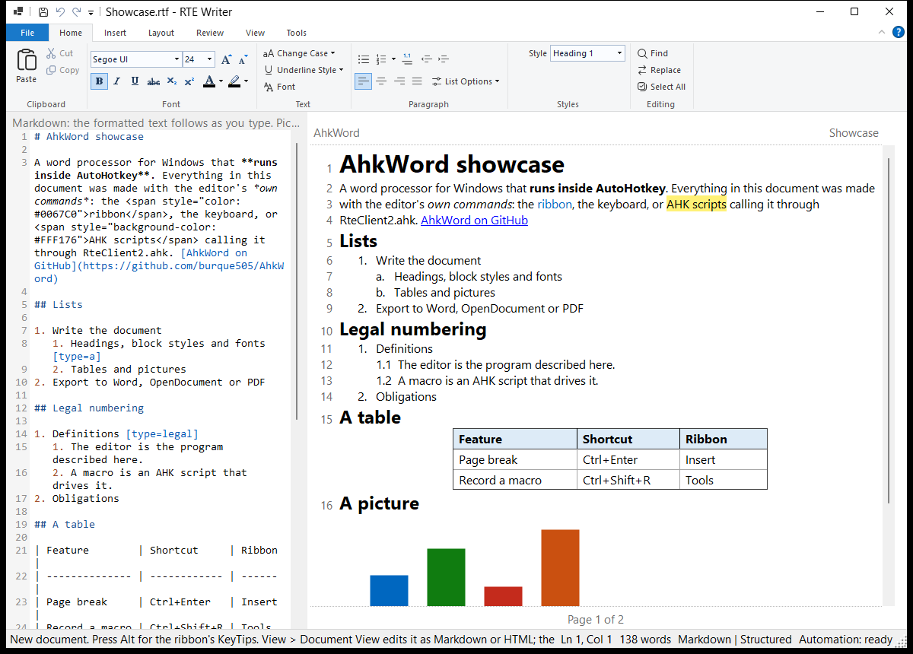

# AhkWord

A word processor for Windows, written in C# and run inside AutoHotkey v2, that AutoHotkey scripts can drive while you type.

AhkWord is built on [RichEditorNET](https://github.com/ellipticbit/RichEditorNET), a .NET wrapper around the Windows RichEdit control, with the Windows Ribbon for its commands. [Csharp-in-AHK](https://github.com/burque505/Csharp-in-AHK) compiles its C# source when it starts and runs it in the AutoHotkey process, so there is no build step and no separate executable.


*[`examples/Showcase.rtf`](examples/Showcase.rtf), made entirely with the editor's own commands. The file has line numbers turned on (Layout > Line Numbers), which this picture doesn't show.*

> **Work in progress.** AhkWord was called **RTE Writer** until iteration 38. On its first start it copies your settings, templates and recovery copies from `%APPDATA%\RTE Writer` into `%APPDATA%\AhkWord` (the old folder is left as it was), and scripts written for RTE Writer keep working.

## Features

- **Documents:** HTML, Markdown (GitHub flavor, with tables and images), plain text and RTF. Word (`.docx`, `.doc`) and OpenDocument (`.odt`) files are opened and saved through a converter (see [Optional converters](#optional-converters)). Export as PDF through "Microsoft Print to PDF".
- **Templates and the start page:** File > New from Template makes a new document from a template: Letter, Memo, Report, Court Paper (with a certificate of service) and Meeting Notes, or your own. Its fields, such as `{{Plaintiff}}`, are asked for (your own details, `{{Your name}}` and the like, are remembered for next time); date fields (`{{Hearing date}}`) get a calendar. Insert > Insert from Template puts a template's content into the document you are writing (the parts Caption, Signature Block and Certificate of Service are made for that), and Insert > Fill In Fields fills in fields left in a document. File > Start Page shows the start page (blank document, templates, recent documents, macros), which can also open at the start. See [Making templates](#making-templates).
- **Several windows:** File > New Window and File > Open in New Window open another editor window, to work on two documents at once. Each window is a complete editor; they share the settings without undoing each other's changes. Scripts started outside the editor talk to the window used last.
- **Autosave and recovery:** while a document has unsaved changes, a recovery copy is written every minute (never over the document's own file). If the editor ends without closing (a crash, a power cut, Windows restarting), the next start offers to recover it. `Rte.AutosaveSeconds` sets the interval (0 turns it off).
- **Styles:** every paragraph has a style (Normal, Title, Subtitle, Heading 1 to 6, Quote, Code, and your own), chosen in the Style box on the Home tab (Ctrl+0 Normal, Ctrl+1 to Ctrl+6 the headings, Ctrl+7 Code). Home > Styles changes a style (Modify Style: font, size, colour, alignment, indents, spacing, line spacing, the line and page breaks, heading level, the style after Enter), makes a new one from a paragraph you have formatted (New Style), or makes a style like such a paragraph (Update Style to Match); its paragraphs change with it, keeping formatting of their own (a bold word; formatting that covers most of a paragraph, such as a pasted line's, gives way, as in Word). **Clear Formatting** (Ctrl+Space) puts the selected text, or with no selection the whole paragraph, back to its style. Copy and paste keep the paragraphs' styles, also between windows. The Styles drop-down shows the document's style set ("Styles: Classic", with "(changed)" once its styles differ from the set's). Three style sets come with it, none of them Word's: **Classic** (Times New Roman 12, black headings; the default), **Plain** (Segoe UI 11) and **Modern** (Georgia with Segoe UI headings). Save Styles as My Default gives new documents your styles. Headings are what their style says, for the outline, Markdown and HTML (a bold line isn't taken for a heading). Styles, with their whole definitions and each paragraph's line and page breaks, are kept in RTF, HTML, and Word and OpenDocument files, whichever converter writes or reads them (Word, LibreOffice or the built-in one), so a document comes back as it was. A document you open keeps its own look: the Styles drop-down then reads "Styles: The document's", and **Apply My Styles** gives it your styles (the ones new documents get), keeping formatting of its own.
- **Paragraph settings:** the Paragraph settings button in Home > Paragraph (and Line Spacing Options) opens a Paragraph dialog like Word's. **Indents and Spacing** sets alignment, left and right indents, a first-line or hanging indent, space before and after, and line spacing. **Line and Page Breaks** sets widow/orphan control, keep with next, keep lines together, page break before and suppress line numbers. A preview shows the result. When the selected paragraphs differ in a setting, it is left empty and stays as each paragraph has it unless you change it. Indents are in inches and spacing in points; you can type any unit (`1.27 cm`, `36pt`, `0.5in`). **Tabs...** sets the paragraphs' tab stops (position, alignment, leader) and the document's default tab stops. **Set As Default...** gives the paragraph's style these settings, for this document only or for new documents too. Modify Style has the same dialog (its Paragraph button), which also has "Don't add space between paragraphs of the same style". Printing, Print Preview, Export as PDF and Multiple Pages keep the line and page break rules, as Word does (RichEdit's own page layout ignores them), and Word and LibreOffice get them in their files. Scripts: `Rte.ParagraphFormat()`, `Rte.SetParagraphFormat("LeftIndent=0.5in; KeepTogether=1")`, `Rte.Tabs`, `Rte.SetTabs(...)`, `Rte.DefaultTabStop`.
- **Formatting:** fonts, colors, highlight, alignment, line spacing (1.0 to 3.0 lines, or at least / exactly so many points, for the selected paragraphs), space before and after paragraphs, change case and underline styles. With nothing selected, a font, size, colour or style chosen applies to what you type next, and to an empty line at once, as in Word. Any font size can be used; headings and other block formats are styles.
- **Lists:** numbered and bulleted lists nested with Tab and Shift+Tab, a numbering style per level, restart and continue numbering, and legal numbering (1., 1.1, 1.1.1). **List levels** (Home > Paragraph > List Options > List levels) sets each level's numbering, start, and where its number and its text start (**Number at**, **Text at**, in points from the margin, as Word's number position and text indent; empty: automatic). They belong to the document and are saved in it and in Word files (a Word document's lists bring theirs), for its lists and legal numbering, and, unless you untick it, for new documents too. Its checkbox **Tab and Shift+Tab give an item its new level's numbering style** (on at first) decides whether a nested item takes its level's style (1. / a. / i.) or keeps its own. Typed numbers in documents from elsewhere can be turned into real lists. **No numbering** (in the Numbering button's menu and in List Options > List style) ends the lists of the selected paragraphs, whatever their numbering.
- **Numbered styles:** a paragraph style can number its paragraphs (Modify Style > Numbering: "1.", "(a)", "i.", "A." and the like, or legal "1.1", at a level from 1 to 9). The **Numbered Paragraph** style numbers paragraphs 1., 2., 3. as court papers and motions do; a style such as "(a)" at level 2 numbers the points under them. How the numbering behaves, so that cutting and pasting never mangles it:
  - All the numbered styles' paragraphs (and legal numbering's) are **one numbering through the document**: it goes on over the paragraphs between them (headings, quotations), and a lower level starts at (a) again under each item above it.
  - Numbers are **worked out from where each paragraph is**: cut a numbered paragraph and the ones after it close up; paste it elsewhere and it **joins the numbering where it lands**, at its level, and everything after it renumbers. Undo takes back the paste and its numbers together. Numbered list items pasted from elsewhere (Word) join too, taking the numbered style of the nearest item of their level.
  - The numbering starts again only where you say (List Options > Restart numbering), and that is kept when the document is saved and opened again.
  - **Numbering off stays off:** a numbered style's paragraph whose numbering you turned off stays unnumbered, with its own indents, when you give it another style and then its style again (through Normal or a heading too, and when saved in between), as in Word. Numbering it again (the Numbering button, Tab) takes that away.
  - **Sub-levels:** Tab on a numbered style's paragraph makes it a point under the one before it (a., b. under 1.; i., ii. a level further), Shift+Tab takes it back out. Tab at the start of a paragraph of a numbered style whose numbering is off makes it a sub-level item too, removing a letter typed in front of it ("a. "); so does Tab over several such paragraphs selected together, and giving a numbered style to paragraphs that start with a typed letter or number of one of its levels. The sub-levels go 1. / a. / i. / (1) / (a) / (i) by default; Modify Style > Sub-levels sets a style's own ("(a), (i)"), and Sub-level indent how much further in each sub-level is (36 pt at first). The style's own indents (Indent left, First line) set where its numbers and lines start. They are kept in saved documents and in Word and OpenDocument files as the list's levels, with the style's indents. A Word style whose list has several levels (Word's own numbered sub-items, not letters typed in) comes in with those levels as sub-levels; letters typed in stay text when a document is opened.
  - A Word document's numbered style (such as its "List Number") comes in as a numbered style, numbered as Word numbers it; Word, LibreOffice and the built-in writer get real Word list numbering back ("1." and "(a)" as Word's own list levels).
  - Giving a paragraph another style takes its number away; turning a style's numbering off takes its paragraphs' numbers away. The number is part of the paragraph's text, kept out of reach of typing (the caret goes after it).
- **Tables:** insert tables, add and delete rows and columns, set column widths, borders (none, all, outside, inside ..., with line width and color), shading, row height, vertical alignment, cell padding and the table's alignment on the page, move between cells with Tab and Shift+Tab (Tab in the last cell adds a row, as in Word), also in tables from Word and other programs.
- **Pages:** manual page breaks (Ctrl+Enter), headers and footers with page-number and date fields, Page Setup, Print Preview (fitted to the screen, with page buttons and zoom), printing, and View > Multiple Pages, which shows the printed pages side by side (read-only: double-click a page to edit it there). Headers and footers are shown in the editor and saved in the document.
- **Print Layout** (on by default, View > Print Layout): lines break where they will on the printed page, as in Word and LibreOffice, and the page is shown on grey, its margins as on paper. **Show Pages** (View > Show Pages, off by default, and not reliable yet: see the known limitations) shows each printed page as a sheet of its own, as in Word: its header and footer in its margins, a grey band between the sheets. The sheets are only the view's: saving, copying, printing and the other formats see the document as it is. With Show Pages off, a dotted line with "Page 2", "Page 3"… marks where each printed page begins, and the header and footer strips number the page in view. Word and OpenDocument files open looking as they do there, not as lines across the whole window. Its zoom, as in Word: **Page Width** (the default: the page fills the window's width, and follows it when the window is resized), **One Page** (a page's height fits the window), or your own (Zoom In, Zoom Out, 100%, Ctrl+mouse wheel), kept when you open another document. Turned off, lines wrap at the window's edge.
- **Line numbers:** as in Word, numbers in the left margin, continuous or restarting on each page, with a first number, every line's number or every 5th (count by), and the distance from the text. Lines in tables and page breaks aren't counted, and you can leave out paragraphs such as headings (Suppress for Current Paragraph). They are printed (also in Print Preview and PDF), numbering the printed lines, and saved in RTF, Word and OpenDocument files, where Word and LibreOffice show and print them. Scripts can ask where a passage is printed: `Rte.PrintedLineAt(position)` gives its page and line, such as `3:12`.
- **Pictures:** insert from a file or by drag and drop, resize, and give them alt text (shown when the mouse rests on a picture).
- **Markdown and HTML views:** edit the document as Markdown or HTML, alone or side by side with the formatted text (see [Markdown and HTML views](#markdown-and-html-views)).
- **Writing tools:** spelling suggestions from the Windows spell checker (F7 goes to the next error) and an outline panel of the headings.
- **Comfort:** recent documents and remembered window and page settings. Drop a file on the window to open it.

## The ribbon

The commands are on a ribbon, the one built into Windows (as in Paint and WordPad): it follows the screen's scaling, and works with the keyboard and screen readers.

| Tab | Groups |
|---|---|
| **File** (menu) | New, New from Template, Start Page, Open, Open in New Window, New Window, Save, Save As, Close (Ctrl+W), Print (with Print Preview and Page Setup), Export (PDF, Word, OpenDocument), Exit, and the recent documents |
| **Home** | Clipboard, Font, Text (change case, underline style, font dialog), Paragraph (lists, levels, No numbering, alignment, Line Spacing, List Options), Styles, Editing (find, replace, select all) |
| **Insert** | Page Break, Table, Picture, Linked Thumbnail, Link, Date & Time |
| **Layout** | Page Setup, Header & Footer, Line Numbers (None, Continuous, Restart Each Page, Suppress for Current Paragraph, Line Numbering Options), Print Preview, Export as PDF |
| **Review** | Next Spelling Error, Add to Dictionary, Check spelling as you type |
| **View** | Document View (Rich Text, Markdown, HTML, Side by Side, Wrap source lines, Source line numbers), Print Layout, Show Pages, Wrap to window, Header and footer, Outline, Zoom (Page Width, One Page, Multiple Pages, Zoom In, Zoom Out, 100%) |
| **Tools** | Macros, Record Macro, Macro Hotkeys, Run Script, Macros Folder, Automation API, About |
| **Table Tools** | Appears while the caret is in a table: insert rows and columns; Properties (column widths, alignment, padding, row height, borders, shading, vertical alignment), Borders and Shading for the selected cells; delete rows, columns or the table |

- **Keyboard:** press **Alt** to see the KeyTips (H Home, N Insert, P Layout, R Review, W View, L Tools, F File). The usual shortcuts work too: Ctrl+B, Ctrl+Shift+N (numbered list), Ctrl+Shift+G (legal numbering), Ctrl+0 to Ctrl+7 (block styles), Ctrl+Enter (page break), F7 (spelling) and more; each button's tooltip shows its shortcut.
- **Numbering:** the arrow next to the Numbering button chooses the numbering style and opens List Levels, where each level's style, punctuation and start number are set. List Options has the rest.
- **Quick access toolbar:** Save, Undo and Redo; its arrow adds New, Open, Print, Print Preview or Export as PDF.

## Markdown and HTML views

**View > Document View** shows the document as **Markdown** or **HTML** in a source editor, alone or **Side by Side** with the formatted text, which follows a moment after you stop typing. Edits in the formatted text show in the source too. The source editor is [Scintilla](https://www.scintilla.org/), with Markdown and HTML syntax colours and line numbers (**View > Source line numbers** turns them off); Ctrl+mouse wheel zooms it.



- **A Markdown editor:** a `.md` file edited in the Markdown view is saved exactly as you typed it: your spacing, list markers and line endings stay. (Edits made in the formatted view are saved as AhkWord writes Markdown.)
- **Formatting keys and buttons insert markup:** in the source view, Ctrl+B gives `**bold**` (or `<strong>` in HTML), Ctrl+1 to Ctrl+6 headings, the list buttons `- ` and `1. ` (renumbered as you indent with Ctrl+M), the alignment keys `<div align>`, and the font control `<span style>`; Table, Link, Picture, Page Break and Date & Time insert theirs. Commands with no Markdown or HTML form say so in the status bar.
- **Line breaks** (Shift+Enter) are `<br>` in HTML, and `\` at the line end (or `<br>` in headings and table cells) in Markdown, as other editors write them; both are read back as line breaks.
- **Tables are lined up:** Markdown tables are written with their columns aligned. In the Markdown view, **Tab** and **Shift+Tab** in a table line it up again and move to the next or previous cell (Tab in the last cell adds a row), and the **Table** button tidies the table the caret is in. Keep a table's rows together: a blank line, or a line without `|`, ends a Markdown table, and what follows shows as typed.
- **Table formatting and line spacing stay in the formatted view.** Markdown tables have no column widths, borders or shading, and Markdown has no line spacing or space between paragraphs of its own, so a `.md` file loses them (they are kept in RTF, Word, OpenDocument and HTML).
- **Tables with long cells are best edited in the formatted view.** A Markdown table row is always a single line, so a table whose cells hold whole paragraphs, such as a two-column block with a signature on one side and a list of names and addresses on the other, becomes very long lines joined with `<br>`. Such tables are written compactly (no padding, `| --- |`) rather than lined up; Tab still moves between their cells, but they are much easier to read and change in the formatted view.
- **HTML is laid out readably:** one paragraph or heading per line, lists and tables indented. Line breaks between blocks don't change how a browser shows a page, so the files look the same.
- **Scripts** can use it too: `Rte.View := "Markdown"`, `Rte.SideBySide := 1`, `Rte.SourceText`.

**Pictures.** In the source view, pictures appear as short names (`embedded-1.png`, ...) instead of their data, and become pictures again when the formatted text is rebuilt. When an HTML or Markdown file is saved, its pictures are written as files to a folder beside it (`document_images\image1.png`, ...) and the file refers to them, which keeps it small and readable. For HTML you can choose **HTML, pictures inside (one file)** in Save As to keep everything in one file instead; files opened that way are saved that way again. For large pictures in a document meant to be read in a browser, consider **Insert > Linked Thumbnail**: a small picture in the page that links to the full-size picture file.

## Automation from AutoHotkey

Any AutoHotkey v2 script can control a running editor through `RteClient2.ahk`:

```ahk
#Requires AutoHotkey v2.0
#Include "RteClient2.ahk"

Rte.InsertText("Hello from AutoHotkey")
Rte.InsertTable(3, 4)
MsgBox Rte.WordCount() " words"
Rte.On("Saved", (e) => TrayTip(Rte.FileName, "Saved"))
```

- **Calls** wait for the editor and return its result. `Rte.Post(...)` queues a call and returns at once. **Tools > Automation API** in the editor lists everything that can be called.
- **Events** (`TextChanged`, `SelectionChanged`, `ModifiedChanged`, `Saved`, `Opened`, `Closed`, `AsyncError`) are delivered to callbacks registered with `Rte.On`.
- **Macros:** the **Macros** button on the Tools tab runs the scripts in [`rte_macros`](rte_macros), and **Macro Hotkeys** gives any of them a hotkey. **Record Macro** (Ctrl+Shift+R) records typing and ribbon commands as a new macro script.
- **Hotkeys in the host script:** `AhkWord.ahk` itself defines a couple of hotkeys (Ctrl+Alt+D inserts the date, Ctrl+Alt+W shows word counts). Add your own there.

The example macros include:

- **Clean up pasted text:** joins lines broken in the middle of sentences, tidies spaces, and makes quotes and dashes typographic.
- **My signature:** inserts your name, title, phone and e-mail (asked for once, then remembered).
- **Collect from anywhere:** select text in any program and press Win+Shift+C to add it, with its source and time, to the end of the document.
- **PDF on save:** each save also makes a PDF beside the document.
- **Folder to PDF:** makes a PDF of every document in a folder.
- **Arrange windows:** puts the open AhkWord windows side by side on the screen (three or fewer in columns, more in a grid), each page fitted to its window's width. Give it a hotkey with Macro Hotkeys.
- An auto-save, a word goal tracker, an event monitor, document statistics, and Title Case for the selection.

## Making templates

A template is an ordinary document with blanks. To make one:

1. **Start from a real document** with the layout you want (a paper you have filed, a letter you have sent), or from a blank one. Whatever the editor keeps (fonts, spacing, tabs, indents, tables, header and footer, line numbers), the template keeps.
2. **Replace each part that changes with a field**, typed into the text:

   | Type | The dialog shows |
   |---|---|
   | `{{Plaintiff}}` | a box labelled "Plaintiff" (the name is the label) |
   | `{{Your role\|Plaintiff}}` | the box, with "Plaintiff" as the default if it is left empty |
   | `{{Your address}}` | a box of several lines (any name with "address" in it); each line becomes a paragraph |
   | `{{Hearing date}}`, `{{Date}}`, `{{execution_date}}` | the box with a calendar beside it (any name with the word "date" in it): pick a day, or type the date as it should read ("on or about June 3") |

   - The same name used several times is asked for once.
   - The filled-in text takes the formatting of the field's first character: format the whole `{{...}}` as the text should look.
   - Use square brackets for text to write by hand, such as `[The first point.]`.
3. **Save it as Rich Text Format into your Templates folder** (`%APPDATA%\AhkWord\Templates`; the start page's "Your templates folder" opens it), named as the template should be called. A piece to insert into other documents (a caption, a signature block) goes into the `Parts` folder inside it instead.
4. **Use it** with File > New from Template, or Insert > Insert from Template for a part. To change it later, open the file itself with File > Open, edit it and save it.

Fields in the header and footer are not filled in (they have their own fields, such as `{page}`). In an RTF file written by hand, the braces are written `\{\{Field\}\}`; the editor does this itself when it saves.
## Requirements

| Component | Notes |
|---|---|
| Windows | 10 or 11 |
| AutoHotkey v2 | **64-bit** (`AutoHotkey64.exe`) |
| .NET runtime | The **.NET 10 Desktop Runtime** (x64), which includes Microsoft.WindowsDesktop.App. The runtime is enough: no SDK is needed |
| C# compiler (Roslyn) | Nothing to install: if none is found, Csharp-in-AHK downloads Microsoft's compiler package from nuget.org on the first start (see [The C# compiler](#the-c-compiler)). Visual Studio or its Build Tools are used if installed |

So the .NET 10 Desktop Runtime and AutoHotkey are all you need to install. Csharp-in-AHK finds .NET by itself. To install the runtime from a command prompt: `winget install Microsoft.DotNet.DesktopRuntime.10` (or `winget install Microsoft.DotNet.SDK.10`, the SDK, which includes it). Having .NET 9 or older is not enough: without .NET 10 the editor stops with an error at start.

The first start downloads what the editor needs, and so takes longer (15 seconds or more, with nothing shown until the window opens): the NuGet packages (RichEditorNET, WindowsRibbon, the Open XML libraries, SkiaSharp and others) and, when no compiler is installed, the C# compiler (about 22 MB). The packages are not in the repository: they come from nuget.org into the computer's NuGet folder (`%USERPROFILE%\.nuget\packages`), as for any .NET program, and are used from there afterwards. If NuGet is set up with no package source (a NuGet.Config without nuget.org), nuget.org is used anyway; if the start fails with `NU1100` or `NU1301`, check that the computer can reach nuget.org (a proxy or firewall), and the sources the message lists.

### The C# compiler

When no compiler path is set and no Visual Studio or Build Tools install is found, Csharp-in-AHK downloads [Microsoft.Net.Compilers.Toolset](https://www.nuget.org/packages/Microsoft.Net.Compilers.Toolset) 5.9.0 from nuget.org, keeps its compiler in `%LOCALAPPDATA%\Csharp-in-AHK\roslyn\5.9.0` and uses it from then on, without the network.

To use a different compiler (a folder with `csc.exe`, `Microsoft.CodeAnalysis.dll` and `Microsoft.CodeAnalysis.CSharp.dll`), run **`Csharp-in-AHK-Paths.ahk`** in this folder, or set `RoslynDir` in `Csharp-in-AHK.ini` (copy `Csharp-in-AHK.example.ini`), or set the environment variable `CSHARP_IN_AHK_ROSLYN`. [Csharp-in-AHK's README](https://github.com/burque505/Csharp-in-AHK#readme) describes the paths in full.

### Optional converters

Word and OpenDocument files are converted by the first of these that is available:

1. **Microsoft Word**, run invisibly, and only when Word isn't already open.
2. **LibreOffice**, run headless with its own profile.
3. **The built-in Open XML converter** (`.docx` only, no extra software needed; tables keep their widths, borders, shading and alignment).
4. **pandoc**.

HTML, Markdown, RTF and plain text need none of them.

Whichever converter opens a `.docx`, its paragraphs get the line spacing and space before and after that Word gives them. These are worked out from the file's document defaults, its styles (a table's style wins over Normal in its cells), each paragraph's own format, and "don't add space between paragraphs of the same style". The built-in converter also keeps the paragraphs' indents, tab stops, tabs and empty paragraphs, both reading and writing. HTML files keep paragraphs' indents, tab stops and spacing too, in table cells as well as outside them.

### Rebuilding the ribbon

The ribbon comes compiled (`ribbon/RteRibbon.ribbon`), so running AhkWord needs nothing more. Only after changing `ribbon/RteRibbon.xml` or the icons, run `ribbon/build_ribbon.ahk`. It needs:

- the **Windows SDK** (for `uicc.exe` and `rc.exe`), and
- the **C++ desktop tools** of Visual Studio or Build Tools (for `link.exe`).

It downloads the [Fluent UI System Icons](https://github.com/microsoft/fluentui-system-icons) font once, draws the icons from it, and compiles the markup into `RteRibbon.ribbon`.

## Getting started

1. Install the requirements above: the .NET 10 Desktop Runtime and 64-bit AutoHotkey v2 (the C# compiler is downloaded on the first start if none is installed).
2. Clone this repository.
3. Run `AhkWord.ahk`. To open a document at start, pass its path: `AhkWord.ahk "C:\path\document.md"`. Try `examples\Showcase.rtf`, and `examples\Styles Tutorial.rtf`, a tutorial on styles, style sets and paragraph settings that uses them itself.

Settings are kept in `%APPDATA%\AhkWord\settings.json`, with the recovery copies beside them in `Recovery`. Set the environment variable `AHKWORD_SETTINGS` (or `RTE_WRITER_SETTINGS`, its old name) to a file path to keep them elsewhere, or `AHKWORD_DATA` to a folder to keep all of AhkWord's files there (settings, templates, recovery copies, the converters' state), as portable mode does.

**Portable mode:** put an empty file named `portable` (or `portable.txt`) beside `AhkWord.ahk`. The settings, the recovery copies and the converters' state (LibreOffice's profile, the log) are then kept in a `data` folder beside it instead of `%APPDATA%` and `%LOCALAPPDATA%`, so the folder can be carried to another computer with them. Macros are already kept beside the program, in `rte_macros`. The .NET packages and the C# compiler stay in the computer's own caches, so a computer that hasn't run it before downloads them once.

## Files

| File | Purpose |
|---|---|
| `AhkWord.ahk` | Starts the editor and holds its in-process hotkeys |
| `AhkWord.cs` | The editor window, the ribbon's commands, the Markdown and HTML views, and the automation interface |
| `rte_markdown6.cs` | Markdown reading and writing |
| `rte_linebreaks.cs` | Line breaks (Shift+Enter) in HTML |
| `rte_htmllists2.cs` | HTML list numbering (start numbers, restarts, styles) |
| `rte_tables2.cs` | Tables and their properties (widths, borders, shading ...) |
| `rte_legal.cs` | Legal numbering |
| `rte_pagebreaks.cs` | Page breaks |
| `rte_headerfooter.cs` | Headers and footers |
| `rte_linenumbers2.cs` | Line numbers: shown beside the text, printed, and kept in the files |
| `rte_sourcebox.cs` | The source editor of the Markdown and HTML views (Scintilla, with syntax colours and line numbers) |
| `rte_office7.cs` | Word, OpenDocument and RTF conversion |
| `rte_linespacing2.cs` | Line spacing and space before and after paragraphs: the ribbon's commands, keeping them in HTML and in the built-in converter's Word files, and giving Word files' paragraphs the spacing Word gives them |
| `rte_printlayout.cs` | Print Layout: the editor's lines laid out as the printer lays them out |
| `rte_pagegaps.cs` | Show Pages: the printed pages as sheets in Print Layout, with their headers and footers |
| `rte_pageview.cs` | Multiple Pages (the printed pages side by side, read-only) and the Print Preview window |
| `rte_styles.cs` | Paragraph styles: the style sets, applying and changing styles, styles in RTF and HTML, the Modify Style dialog |
| `rte_paragraph.cs` | The Paragraph and Tabs dialogs, paragraph formats for scripts, and where printed pages end (keep with next, keep lines together, widow and orphan control, page break before) |
| `rte_docxstyles.cs` | Styles in the .docx files the built-in converter writes and reads (and in LibreOffice's .odt files, which are read through it): the styles' definitions, and each paragraph's style and line and page breaks |
| `rte_templates.cs` | Templates with fields, and the start page |
| `templates\` | The templates that come with the editor (and the parts, in `templates\Parts`) |
| `rte_recovery.cs` | Autosaved recovery copies, and where the editor keeps its files (portable mode) |
| `ribbon\RteRibbon.xml` | The ribbon's markup: tabs, groups, commands, KeyTips and tooltips |
| `ribbon\RteRibbon.ribbon` | The compiled ribbon (a resource-only DLL) that the editor loads |
| `ribbon\build_ribbon.ahk`, `ribbon\make_icons.cs` | Rebuild the ribbon and its icons |
| `RteClient2.ahk` | The `Rte` class for scripts that control the editor |
| `rte_macros\` | Example macros |
| `examples\Showcase.rtf` | The showcase document in the picture above |
| `Csharp-in-AHK.ahk` | A copy of [Csharp-in-AHK](https://github.com/burque505/Csharp-in-AHK), matching its commit `4a4b93e` |
| `Csharp-in-AHK-Paths.ahk`, `Csharp-in-AHK.example.ini` | From the same commit: a window for choosing where .NET and the C# compiler are, and the template for `Csharp-in-AHK.ini` |
| `Csx-in-AHK.ahk` | From the same commit: Csharp-in-AHK's C# script library, which `Csharp-in-AHK-Paths.ahk` needs (the editor doesn't use it) |

## Running an earlier iteration

`make_version.ps1` makes a complete, runnable copy of any committed iteration (`.\make_version.ps1 33`, or `-All`), or of the files as they are now (`-Working`, stamped with the date and time), in `..\rte-versions`, beside this folder. Each copy stands alone, with no link to git, so nothing done here can change it. Its program files are read-only, and it runs in portable mode, keeping its settings in its own `data` folder rather than yours. Run it with its own `AhkWord.ahk` (`rte_writerNN.ahk` for iterations up to 38); `VERSION.txt` says which iteration it is. (The modules are edited in place from one iteration to the next, so an old copy's program runs only beside the modules of its own time.) `-List` lists the copies there are.

## Known limitations

- **Table borders are single lines.** Double, dotted and other border styles from Word documents show and are saved as single lines of the same width and color; RichEdit draws only single lines.
- **Merged cells can't be made.** Tables from Word with merged cells open, but AhkWord can't merge or split cells.
- **Markdown has no table formatting or paragraph spacing.** Column widths, borders, shading, line spacing and space before and after paragraphs are kept in RTF, Word, OpenDocument and HTML files, not in Markdown (see [Markdown and HTML views](#markdown-and-html-views)).
- **Markdown table rows are single lines,** so tables whose cells hold paragraphs are best edited in the formatted view.
- **On-screen line numbers match the printed ones in Print Layout only.** With View > Print Layout (the default), the editor's lines are the printed lines, at any zoom. With it off, lines wrap at the window's edge, so a line's number on screen can differ from its printed number; printing, Print Preview, PDF export and `Rte.PrintedLineAt` always number the printed lines.
- **Show Pages is a preview, not reliable for typing yet.** The view can shift up and down while you type (most in a new or short document, and when headers and footers are turned off and on), because the sheets are made by changing the layout of the lines at the pages' ends. Leave it off to write, and turn it on to look the pages over; a redesign that keeps the view still while typing is planned. A page that ends inside a table is not split into sheets (RichEdit can't leave a gap inside a table row): the next page is marked with a "Page N" line instead. Letters are drawn with the screen's fonts, so a line can look a little longer or shorter than on paper while breaking in the same place.
- **Suppressed line numbers need RTF, or Word or LibreOffice as the converter.** HTML, Markdown, pandoc and the built-in converter keep the line numbering but not which paragraphs are left out. OpenDocument files have no first number: their lines start at 1.

## License

AhkWord is under the [MIT license](LICENSE). The components it uses are under their own licenses: see [THIRD-PARTY-NOTICES.md](THIRD-PARTY-NOTICES.md) and [`licenses/`](licenses).
