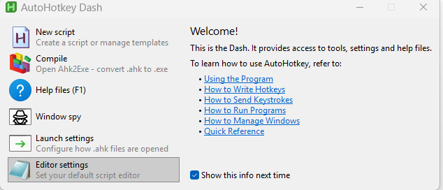

# Primeros pasos

## 1. Obtener AhkWord

=== "La descarga (nada que instalar)"

    1. En la [página de versiones](https://github.com/burque505/AhkWord/releases), descargue el **AhkWord-NN.zip** más reciente, o **AhkWord-NN-complete.zip** si el equipo podría no tener .NET 10 o no está conectado a Internet (este lleva .NET dentro).
    2. Descomprímalo en cualquier lugar donde pueda escribir: sus Documentos, una memoria USB (no en Archivos de programa, que Windows mantiene de solo lectura).
    3. Haga doble clic en **AhkWord.exe**. La primera vez Windows puede decir *Windows protegió su PC*, porque AhkWord no está firmado: haga clic en **Más información** y luego en **Ejecutar de todas formas**.

    Todo lo que AhkWord necesita está en su carpeta: sus bibliotecas, las DLL del compilador de C# y AutoHotkey (`AhkWord.exe` es AutoHotkey v2, sin cambios, con el nombre de AhkWord; está bajo la GNU GPL, su licencia y el enlace a su código fuente vienen en el zip, y las licencias de las demás partes están en `THIRD-PARTY-NOTICES.md` y `licenses`). En el primer inicio no se descarga nada, y fuera de la carpeta no se escribe nada salvo su configuración (vea más abajo); para quitar AhkWord, borre su carpeta.

    AhkWord funciona con el **.NET 10 Desktop Runtime** de Microsoft. Si el equipo lo tiene, AhkWord lo usa. Si no, AhkWord pregunta la primera vez:

    - **Descargarlo solo para AhkWord** (recomendado): los archivos de Microsoft (unos 70 MB), comprobados con las sumas de verificación de Microsoft, van a la carpeta de AhkWord (`dotnet`). No se instala nada en Windows y no hace falta ser administrador.
    - **Instalarlo para todo Windows**: se abre la página de descarga de Microsoft; vuelva a iniciar AhkWord cuando esté instalado.
    - **Ahora no**: AhkWord se cierra, y vuelve a preguntar la próxima vez.

    La descarga completa ya trae .NET en su carpeta `dotnet`, así que no pregunta nada.

    **Mantener al día el .NET propio de AhkWord.** Microsoft corrige .NET aproximadamente una vez al mes, a menudo por seguridad, y Windows Update no sabe de un .NET que está en la carpeta de AhkWord. Por eso, cuando AhkWord funciona con su propia carpeta `dotnet`, consulta una vez por semana, en segundo plano, la lista de versiones de .NET 10 de Microsoft (un archivo pequeño, de unos 40 KB, de Microsoft; el inicio de AhkWord nunca lo espera). Cuando la lista tiene un .NET más nuevo que el de la carpeta, el siguiente inicio pregunta:

    - **Actualizar ahora** (recomendado): el nuevo .NET se descarga y se comprueba como el primero, y ocupa el lugar del anterior. Si queda abierta otra ventana de AhkWord, no se puede reemplazar: no cambia nada, y AhkWord indica que cierre las demás ventanas y lo inicie de nuevo.
    - **Más tarde**: vuelve a preguntar la próxima vez.
    - **Omitir** esa versión: vuelve a preguntar cuando Microsoft publique la siguiente.

    Aparte de esa lista, nunca se descarga nada sin preguntar. Para que AhkWord no consulte nada, ponga un archivo vacío llamado `no-update-check` junto a `AhkWord.exe`. Un .NET instalado para todo Windows lo mantiene al día Windows Update, y AhkWord se lo deja a él.

=== "Desde el repositorio (con AutoHotkey instalado)"

    1. Instale **AutoHotkey v2**, de 64 bits, desde [autohotkey.com](https://www.autohotkey.com/), y el **.NET 10 Desktop Runtime** (64 bits), una vez por equipo: en una terminal, `winget install Microsoft.DotNet.DesktopRuntime.10`, o descárguelo para x64 desde [dotnet.microsoft.com](https://dotnet.microsoft.com/download/dotnet/10.0). Un .NET anterior (9 o antes) no basta.
    2. Clone o descargue [el repositorio](https://github.com/burque505/AhkWord).
    3. Ejecute **AhkWord.ahk**. Para abrir un documento al iniciar, pase su ruta: `AhkWord.ahk "C:\ruta\documento.docx"`.

    El primer inicio tarda uno o dos minutos, sin mostrar nada hasta que se abre la ventana: AhkWord descarga los componentes de los que está hecho (de nuget.org, a la carpeta NuGet del equipo) y se compila.

## 2. El primer inicio

Una descarga de versión trae AhkWord ya compilado, así que ni su primer inicio compila nada (el primer inicio puede tardar unos segundos más mientras Windows comprueba los archivos nuevos). Ejecutado desde el repositorio, AhkWord se compila en el primer inicio y guarda el resultado, así que los inicios siguientes tardan unos dos segundos; cuando cambia un archivo de código fuente, se compila una vez más.

## 3. AhkWord en español

La interfaz de AhkWord (la cinta, los menús, los cuadros de diálogo y la barra de estado) está en inglés o en español. Para tenerla en español, elija **Review > Language > Español** (en español, **Revisar > Idioma**): AhkWord está en español desde el siguiente inicio. Vea [Language](reference/settings.md#language) para otras formas de elegirlo.

Luego pruebe los documentos de ejemplo de la carpeta `examples`:

- **Showcase.rtf**, el documento de la imagen de la [página de inicio](index.md) (en inglés), hecho por completo con los propios comandos de AhkWord;
- **Styles Tutorial.rtf**, un tutorial breve (en inglés) sobre estilos, conjuntos de estilos y configuración de párrafos, que los usa él mismo.

!!! tip "Anclarlo a la barra de tareas"
    Haga clic derecho en el botón de AhkWord en la barra de tareas y elija **Anclar a la barra de tareas**: el botón anclado inicia AhkWord, con su propio icono, aparte de cualquier otro script de AutoHotkey que ejecute.

## Dónde se guarda su configuración

AhkWord guarda su configuración, sus propias plantillas y sus copias de recuperación en `%APPDATA%\AhkWord` (escríbalo en la barra de direcciones del Explorador para ir allí), y los archivos de trabajo de los convertidores en `%LOCALAPPDATA%\AhkWord`. No se escribe nada junto al programa, así que puede actualizar AhkWord reemplazando su carpeta.

**Modo portátil:** ponga un archivo vacío llamado `portable` (o `portable.txt`) junto a `AhkWord.exe` o `AhkWord.ahk`, y AhkWord guarda todo eso en una carpeta `data` junto a sí mismo, de modo que puede llevar la carpeta a otro equipo, en una memoria USB por ejemplo. Sus macros, fragmentos y macros de eventos van con ella, y las macros de eventos funcionan en cualquier equipo, con o sin AutoHotkey; solo el programa que edita una macro es el de cada equipo (vea [Qué programa abre una macro](#which-program-opens-a-macro-to-edit-it)). [Settings and folders](reference/settings.md) tiene los detalles, y otras formas de elegir las carpetas.

## ¿Es nuevo en AutoHotkey?

[AutoHotkey](https://www.autohotkey.com/) es un lenguaje de scripts gratuito para Windows, para teclas de acceso rápido, abreviaturas y programas pequeños. AhkWord funciona sobre él, pero **no hace falta conocerlo, ni instalarlo, para escribir documentos**: la descarga lo trae como `AhkWord.exe`.

Lo que AutoHotkey añade es que AhkWord se puede automatizar, si usted lo desea:

- **Macros** (Herramientas > Macros): scripts que hacen cosas en el documento por usted. **Grabar macro** escribe una a partir de lo que usted teclea y pulsa, así que puede hacer una sin escribir código.
- **Fragmentos** (Insertar > Fragmentos): escriba una abreviatura como `;sig` y se convierte en su bloque de firma.
- **Teclas de macro** y **macros de eventos** (Herramientas > Macros de eventos): una macro en una tecla, o que se ejecuta sola cuando se abre o se guarda un documento.

Las macros son archivos de texto plano que terminan en `.ahk`, en la carpeta `rte_macros` junto a AhkWord. [Automation](automation/index.md) tiene los detalles.

### Qué programa abre una macro para editarla { #which-program-opens-a-macro-to-edit-it }

**Editar** en AhkWord (en Herramientas > Macros de eventos, por ejemplo) usa el programa que Windows tiene para editar archivos `.ahk`, el que abre **Edit script** en el menú del clic derecho del Explorador.

- **Con AutoHotkey instalado,** AutoHotkey le pregunta la primera vez qué editor usar (el Bloc de notas, o un editor de código que encuentre en el equipo), y recuerda su respuesta para su usuario de Windows. Para elegir otro más adelante, abra el **AutoHotkey Dash** y haga clic en **Editor settings**. La macro *Open AutoHotkey Dash* (Herramientas > Macros) lo abre desde AhkWord; también AutoHotkey Dash en el menú Inicio.
- **Sin AutoHotkey instalado,** como con la descarga de AhkWord sola, AhkWord abre la macro en el **Bloc de notas**. (El Dash viene con AutoHotkey; la copia de AutoHotkey de AhkWord no lo trae.)

*El AutoHotkey Dash. **Editor settings** elige el programa que edita los scripts; **Window spy** muestra el nombre y los controles de una ventana, lo que ayuda cuando una macro trabaja con otros programas.*

Sirve cualquier editor de texto. Un editor de código con soporte para AutoHotkey colorea el código y detecta errores: Visual Studio Code con una extensión para AutoHotkey v2, o Notepad++, por ejemplo.

### Para saber más, y una advertencia

**Herramientas > API de automatización** enumera todo lo que una macro puede pedirle a AhkWord, una macro grabada muestra las llamadas de lo que usted hizo, y la [documentación](https://www.autohotkey.com/docs/v2/) de AutoHotkey explica el lenguaje (en inglés).

Una macro es un programa, y puede hacer en su equipo todo lo que puede hacer un programa. Ejecute, o asocie a un evento, solo macros que haya escrito usted o que le haya dado alguien de confianza.

## Después

- La [Guía del usuario](guide/documents.md), empezando por abrir y guardar documentos (en inglés por ahora).
- [Para la redacción jurídica](legal.md), si redacta escritos, demandas o contratos.
- [Solución de problemas](reference/troubleshooting.md), si el primer inicio no va como se describe.
