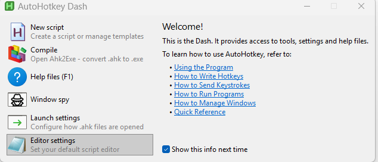

# Getting started

## 1. Get AhkWord

=== "The download (nothing to install)"

    1. On the [Releases page](https://github.com/burque505/AhkWord/releases), download the newest **AhkWord-NN.zip**, or **AhkWord-NN-complete.zip** if the computer may not have .NET 10 or isn't online (it has .NET inside).
    2. Unzip it anywhere you can write to: your Documents, a USB stick (not Program Files, which Windows keeps read-only).
    3. Double-click **AhkWord.exe**. Windows may say *Windows protected your PC* the first time, as AhkWord isn't signed: click **More info**, then **Run anyway**.

    Everything AhkWord needs is in its folder: its libraries, the C# compiler's DLLs and AutoHotkey (`AhkWord.exe` is AutoHotkey v2, unchanged, under AhkWord's name; it is under the GNU GPL, its license and source link are in the zip, and the other parts' licenses are in `THIRD-PARTY-NOTICES.md` and `licenses`). Nothing is downloaded at the first start, and nothing is written outside the folder but your settings (see below); to remove AhkWord, delete its folder.

    AhkWord runs on Microsoft's **.NET 10 Desktop Runtime**. If the computer has it, AhkWord uses it. If not, AhkWord asks the first time:

    - **Download it for AhkWord only** (recommended): Microsoft's own files (about 70 MB), checked against Microsoft's checksums, go into AhkWord's folder (`dotnet`). Nothing is installed in Windows and no administrator is needed.
    - **Install it for all of Windows**: Microsoft's download page opens; start AhkWord again once it is installed.
    - **Not now**: AhkWord closes, and asks again next time.

    The complete download has .NET in its `dotnet` folder already, so it asks nothing.

=== "From the repository (AutoHotkey installed)"

    1. Install **AutoHotkey v2**, 64-bit, from [autohotkey.com](https://www.autohotkey.com/), and the **.NET 10 Desktop Runtime** (64-bit), once per computer: in a terminal, `winget install Microsoft.DotNet.DesktopRuntime.10`, or download it for x64 from [dotnet.microsoft.com](https://dotnet.microsoft.com/download/dotnet/10.0). An older .NET (9 or before) is not enough.
    2. Clone or download [the repository](https://github.com/burque505/AhkWord).
    3. Run **AhkWord.ahk**. To open a document at the start, pass its path: `AhkWord.ahk "C:\path\document.docx"`.

    The first start takes a minute or two, with nothing shown until the window opens: AhkWord downloads the components it is made of (from nuget.org, into your computer's NuGet folder) and compiles itself.

## 2. The first start

AhkWord compiles itself as it starts, so the first start takes a little longer, and later starts a few seconds.

Then try the example documents in the `examples` folder:

- **Showcase.rtf**, the document in the picture on the [home page](index.md), made entirely with AhkWord's own commands;
- **Styles Tutorial.rtf**, a short tutorial on styles, style sets and paragraph settings, which uses them itself.

!!! tip "Pin it to the taskbar"
    Right-click AhkWord's taskbar button and choose **Pin to taskbar**: the pinned button starts AhkWord, with its own icon, apart from any other AutoHotkey scripts you run.

## Where your settings are kept

AhkWord keeps its settings, your own templates and its recovery copies in `%APPDATA%\AhkWord` (type that into Explorer's address bar to go there), and the converters' working files in `%LOCALAPPDATA%\AhkWord`. Nothing is written beside the program, so you can update AhkWord by replacing its folder.

**Portable mode:** put an empty file named `portable` (or `portable.txt`) beside `AhkWord.exe` or `AhkWord.ahk`, and AhkWord keeps all of that in a `data` folder beside itself instead, so you can carry the folder to another computer, on a USB stick for instance. Your macros, snippets and event hooks go with it, and the hooks run on any computer, with or without AutoHotkey; only the program that edits a macro is each computer's own (see [Which program opens a macro](#which-program-opens-a-macro-to-edit-it)). [Settings and folders](reference/settings.md) has the details, and other ways to choose the folders.

## New to AutoHotkey?

[AutoHotkey](https://www.autohotkey.com/) is a free scripting language for Windows, for hotkeys, abbreviations and small programs. AhkWord runs on it, but **you don't need to know it, or install it, to write documents**: the download carries it as `AhkWord.exe`.

What AutoHotkey adds is that AhkWord can be automated, if you want that:

- **Macros** (Tools > Macros): scripts that do things in the document for you. **Record Macro** writes one from what you type and click, so you can make one without writing any code.
- **Snippets** (Insert > Snippets): type an abbreviation such as `;sig` and it becomes your signature block.
- **Macro hotkeys** and **event hooks** (Tools > Event Hooks): a macro on a key, or run by itself when a document is opened or saved.

Macros are plain-text files ending in `.ahk`, in the `rte_macros` folder beside AhkWord. [Automation](automation/index.md) has the details.

### Which program opens a macro to edit it

**Edit** in AhkWord (in Tools > Event Hooks, for instance) uses the program Windows has for editing `.ahk` files, the one Explorer's right-click **Edit script** opens.

- **With AutoHotkey installed,** AutoHotkey asks you the first time which editor to use (Notepad, or a code editor it finds on the computer), and remembers your answer for your Windows user. To choose another later, open the **AutoHotkey Dash** and click **Editor settings**. The *Open AutoHotkey Dash* macro (Tools > Macros) opens it from AhkWord; so does AutoHotkey Dash in the Start menu.
- **Without AutoHotkey installed,** as with AhkWord's own download alone, AhkWord opens the macro in **Notepad**. (The Dash comes with AutoHotkey; AhkWord's copy of AutoHotkey doesn't have it.)

*The AutoHotkey Dash. **Editor settings** chooses the program that edits scripts; **Window spy** shows a window's name and controls, which helps when a macro works with other programs.*

Any text editor will do. A code editor with AutoHotkey support colours the code and catches mistakes: Visual Studio Code with an AutoHotkey v2 extension, or Notepad++, for instance.

### Learning more, and a caution

**Tools > Automation API** lists everything a macro can ask AhkWord to do, a recorded macro shows the calls for what you did, and AutoHotkey's own [documentation](https://www.autohotkey.com/docs/v2/) covers the language.

A macro is a program, and it can do anything a program can on your computer. Run, or hook to an event, only macros you wrote yourself or got from someone you trust.

## Next

- The [User guide](guide/documents.md), starting with opening and saving documents.
- [For legal drafting](legal.md), if you write pleadings, motions or contracts.
- [Troubleshooting](reference/troubleshooting.md), if the first start doesn't go as described.
