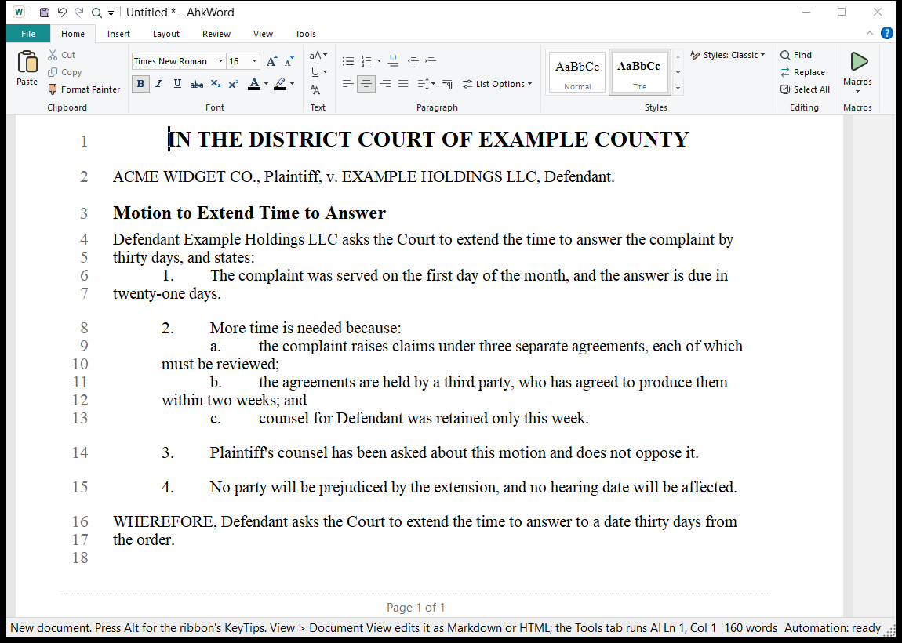

# Números de línea

**Disposición > Números de línea** numera las líneas en el margen izquierdo, como hace Word, para escritos judiciales y contratos:

- **Continua**, o **Reiniciar en cada página**; **Ninguno** los desactiva.
- **Opciones de numeración de líneas:** el primer número, numerar cada línea o solo una de cada 5 (el intervalo), y la distancia al texto.
- **Suprimir en el párrafo actual** omite párrafos como los títulos. Las líneas de las tablas y los saltos de página no se cuentan.

Los números se imprimen (también en la Vista previa de impresión y en el PDF), numerando las líneas impresas, y se guardan en los archivos RTF, Word y OpenDocument, donde Word y LibreOffice los muestran e imprimen.

Con Diseño de impresión activado (el predeterminado), los números en pantalla son los impresos, con cualquier zoom. Con él desactivado, las líneas se ajustan al borde de la ventana y el número de una línea en pantalla puede diferir de su número impreso; la impresión y el PDF siempre numeran las líneas impresas.

!!! tip "Citar una página y una línea"
    Un script puede preguntar dónde se imprime un pasaje: `Rte.PrintedLineAt(position)` da su página y su línea, como `3:12`.

Qué párrafos se omiten se conserva en RTF, y en los archivos de Word y OpenDocument escritos a través de Word o LibreOffice; HTML, Markdown, pandoc y el convertidor integrado conservan la numeración de líneas pero no eso. OpenDocument no tiene primer número: sus líneas empiezan en 1.
