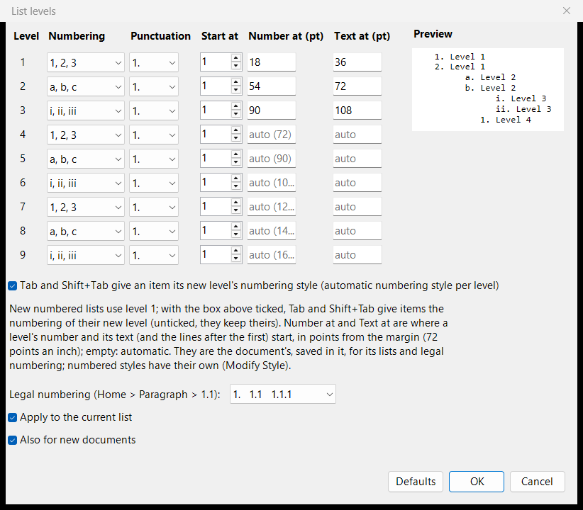
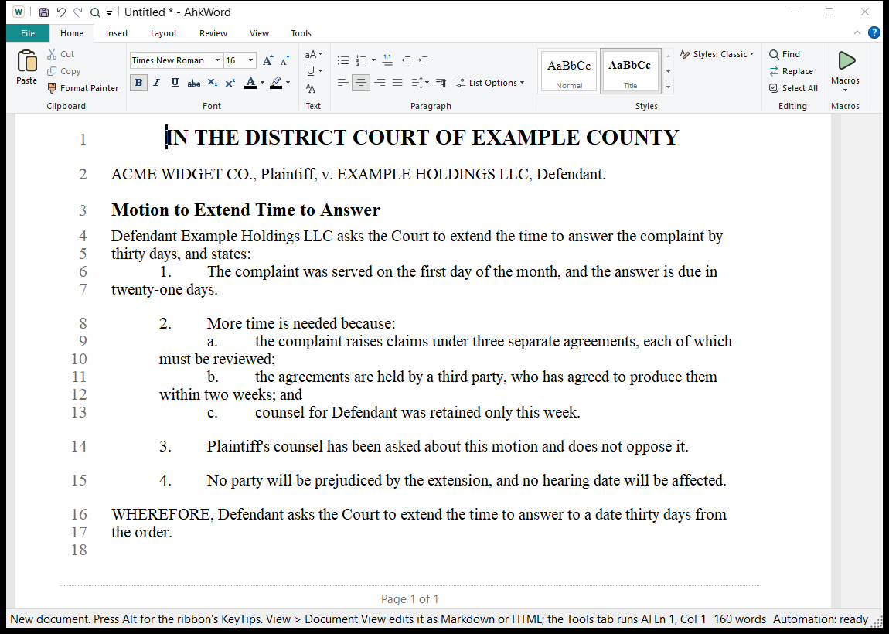

# Listas y numeración

AhkWord tiene tres clases de numeración, que funcionan juntas:

| Clase | Se hace con | Para |
|---|---|---|
| **Listas** | los botones Viñetas y Numeración | listas con viñetas y numeradas en texto corriente |
| **Numeración legal** | el botón **1.1** (Ctrl+Mayús+G) | esquemas numerados 1., 1.1, 1.1.1 |
| **Estilos numerados** | un estilo de párrafo con numeración, como **Numbered Paragraph** | los párrafos numerados de escritos judiciales, solicitudes y contratos |

## Listas { #lists }

Los botones **Viñetas** y **Numeración** de Inicio > Párrafo convierten en lista los párrafos seleccionados (Ctrl+Mayús+N: numerada). La flecha junto a Numeración elige el estilo: 1, 2, 3; a, b, c; A, B, C; i, ii, iii; I, II, III.

- **Tab** y **Mayús+Tab** mueven un elemento un nivel hacia dentro o hacia fuera.
- **Reiniciar numeración** y **Continuar numeración** (en el menú Numeración y en Opciones de lista) empiezan una lista de nuevo en un número, o siguen la de la lista anterior.
- **Sin numeración** termina las listas de los párrafos seleccionados, sea cual sea su numeración: los números se van y el texto se queda.
- **Convertir números escritos en listas** (Opciones de lista) convierte los números escritos a mano, como los que tienen algunos documentos de otras procedencias, en una lista de verdad.

## Niveles de lista { #list-levels }

**Niveles de lista...** (en el menú Numeración y en Opciones de lista) fija, para cada uno de los nueve niveles:

- su estilo de **numeración** y su **puntuación** (1. 1) (1) 1), y el número en que **inicia**;
- **Número en** y **Texto en**: dónde empieza el número del nivel y dónde empieza su texto (y las líneas después de la primera), en puntos desde el margen (72 puntos por pulgada), como la *posición del número* y la *sangría del texto* de Word. Déjelos vacíos para que sean automáticos: el número 18 puntos más adentro en cada nivel, y el texto justo después de él.

Marque **Tab y Mayús+Tab dan a un elemento el estilo de numeración de su nuevo nivel** (marcada al principio) para tener 1. / a. / i. a medida que los elementos se mueven hacia dentro; desmárquela y los elementos conservan su propio estilo.

Los niveles son del documento: se guardan en él, y en los archivos de Word como los niveles propios de las listas, y un documento de Word que abre trae las sangrías de sus listas. **También para documentos nuevos** (marcada al principio) los hace también sus niveles para los documentos nuevos. **Aplicar a la lista actual** da los nuevos niveles a una lista que ya existe.

## Numeración legal { #legal-numbering }

El botón **1.1** (Ctrl+Mayús+G) numera los párrafos seleccionados 1., 1.1, 1.1.1 según su nivel: Tab y Mayús+Tab mueven un elemento un nivel hacia dentro o hacia fuera, y Entrar, Retroceso y Supr mantienen bien los números. Niveles de lista fija dónde empiezan el número y el texto de cada nivel, y si los números terminan en punto (1. 1.1 1.1.1, o 1. 1.1. 1.1.1., o ninguno). Word y LibreOffice reciben una numeración de lista de verdad, que se renumera sola cuando el documento se edita allí.

## Estilos numerados { #numbered-styles }

Un estilo de párrafo puede numerar sus párrafos: **Modificar estilo > Numeración** elige el formato ("1.", "(a)", "i.", "A." y similares, o el legal "1.1") y el nivel, de 1 a 9. El estilo **Numbered Paragraph** que trae AhkWord numera los párrafos 1., 2., 3., como los escritos judiciales y las solicitudes; un estilo numerado "(a)" en el nivel 2 numera los puntos que van debajo de ellos.

Los estilos numerados están hechos para que **cortar y pegar nunca estropee la numeración**:

- **Una sola numeración en todo el documento.** Todos los párrafos de los estilos numerados (y los de la numeración legal) se cuentan juntos, por encima de los párrafos que hay entre ellos, como títulos y citas. Un nivel inferior empieza de nuevo en (a) bajo cada elemento de arriba.
- **Los números salen de dónde está cada párrafo.** Corte un párrafo numerado y los siguientes se recorren; péguelo en otro sitio y **se une a la numeración donde cae**, en su nivel, y todo lo que va después se renumera. Deshacer revierte a la vez el pegado y sus números. Los elementos numerados pegados desde Word también se unen.
- **Solo empieza de nuevo donde usted lo dice:** Opciones de lista > Reiniciar numeración, que se conserva al guardar el documento y volver a abrirlo.
- **El número es parte del párrafo**, fuera del alcance de lo que escribe: el cursor va después de él.

### Subniveles { #sub-levels }

**Tab** en un párrafo numerado lo convierte en un punto bajo el anterior (a., b. bajo 1.; i., ii. un nivel más adentro); **Mayús+Tab** lo vuelve a sacar. Los subniveles van 1. / a. / i. / (1) / (a) / (i), a menos que el estilo diga otra cosa: **Modificar estilo > Subniveles** fija los propios de un estilo ("(a), (i)"), y **Sangría de subnivel**, cuánto más adentro va cada subnivel (36 puntos al principio). Las sangrías propias del estilo (*Sangría izquierda*, *Primera línea*) fijan dónde empiezan sus números y sus líneas.

**Espacio entre subniveles** fija cómo se aplica el *espacio posterior* de un estilo a sus subniveles: **Ninguno** (al principio) mantiene juntos un párrafo y sus puntos, sin espacio después del párrafo ni entre sus puntos, y con el espacio posterior del estilo tras el último punto; **Solo después del párrafo de arriba** deja el espacio después del párrafo pero ninguno entre sus puntos; **Después de cada uno** da a cada párrafo el espacio posterior del estilo. Un párrafo cuyo espacio posterior fijó usted mismo (cuadro de diálogo Párrafo) lo conserva.

Tab al principio de un párrafo de un estilo numerado cuya numeración está desactivada (vea más abajo) también lo convierte en un elemento de subnivel, y quita una letra escrita delante de él ("a. "). Lo mismo hace Tab sobre varios de esos párrafos seleccionados juntos.

### Sin numeración { #numbering-off }

**Sin numeración** en un párrafo de un estilo numerado le quita el número y le deja el estilo, como la "numeración desactivada" de Word: un párrafo sin número dentro de una serie de párrafos numerados. Sigue sin número, con sus propias sangrías, cuando le da otro estilo y luego otra vez el suyo (también pasando por Normal o por un título, y cuando el documento se guarda entretanto). Numerarlo de nuevo (el botón Numeración, o Tab) lo deshace.

### Los estilos numerados y Word { #numbered-styles-and-word }

El estilo numerado de un documento de Word (como su *List Number*) entra como estilo numerado, numerado como lo numera Word, con sus subelementos como subniveles. Word, LibreOffice y el convertidor integrado reciben de vuelta una numeración de lista de Word de verdad, cada nivel con su formato, con las sangrías del estilo. Dar otro estilo a un párrafo le quita el número; desactivar la numeración de un estilo quita los números de sus párrafos.

## Referencias cruzadas { #cross-references }

**Insertar > Referencia cruzada** hace referencia a un párrafo numerado: "vea el párrafo 3(b)". Elija el párrafo, y si mostrar **su número** ("(b)") o **su número completo**, con los niveles superiores ("3(b)"); se omite un punto final ("1." es "1"), y un subnivel con letras o con números romanos se escribe entre paréntesis, como en las citas ("23(e)", "5(a)(iii)"). Funciona con la numeración legal, los estilos numerados y las listas numeradas, y con los subpuntos escritos delante de los párrafos que siguen a uno numerado ("e. " al principio del texto): estos se ofrecen bajo su párrafo, como "23(e)".

El número sigue al del párrafo: cuando se agregan, mueven o renumeran párrafos, las referencias cambian con ellos (en el mismo paso de deshacer). Las referencias a los elementos de una lista numerada corriente se ponen al día antes de guardar, imprimir y exportar, y con **F9** (**Insertar > Actualizar**). **Ctrl+clic** en una referencia va a su párrafo. Si se borra el párrafo al que hacía referencia, la referencia dice "(reference not found)".

Las referencias se conservan en todos los formatos: los archivos de Word y OpenDocument reciben las propias referencias cruzadas de Word (marcadores y campos REF), que Word y LibreOffice también mantienen al día, y las referencias hechas en Word entran como referencias cruzadas; HTML y Markdown reciben vínculos a anclas. Los scripts usan `CrossReferenceTargets`, `InsertCrossReference` y `UpdateCrossReferences` (vea la [referencia de la API](../automation/api.md), en inglés).

## Notas a pie { #footnotes }

**Insertar > Nota a pie** (Ctrl+Alt+F) pone una nota a pie en el cursor: un número en superíndice en el texto, y su nota al pie de la página. Las notas a pie se numeran 1, 2, 3 en orden, y se numeran de nuevo al agregar o quitar una (F9 las pone al día después de borrar una junto con su texto).

Las notas se imprimen al pie de su página bajo una línea corta, como en Word, y la página les hace sitio; **Vista > Mostrar páginas** también las muestra allí en las hojas. En otros lugares, pase el puntero sobre el número de una nota a pie para ver su nota. **Ctrl+clic** en el número (o Insertar > Nota a pie con el cursor sobre él) cambia la nota; una nota vacía quita la nota a pie. Una nota puede tener más de un párrafo, como en Word: en el cuadro de diálogo de la nota a pie, **Entrar** empieza un párrafo nuevo y **Ctrl+Entrar** es Aceptar. Sus palabras pueden ir en **negrita**, *cursiva* y subrayadas (los botones B, I y U del cuadro de diálogo, o Ctrl+B, Ctrl+I y Ctrl+U allí). El tamaño de las notas es el del estilo **Footnote Text** del documento: fíjelo en el cuadro de diálogo de la nota a pie (*Tamaño de todas las notas*) o con Modificar estilo (también su fuente). Un documento sin ese estilo tiene notas de tres cuartos del tamaño de su texto (9 puntos para texto de 12 puntos); uno abierto desde Word o LibreOffice conserva el tamaño de sus notas, y se lo devuelve al guardarse.

Los archivos de Word y OpenDocument reciben notas a pie de verdad, y las notas a pie hechas en Word o LibreOffice entran como notas a pie; HTML recibe vínculos numerados a una lista de las notas al final, y Markdown su forma de nota a pie (`[^1]` y `[^1]: la nota`, con sus párrafos siguientes sangrados cuatro espacios). Los párrafos, la negrita, la cursiva y el subrayado de las notas las acompañan en todos los formatos; un salto de línea en una nota de Word (Mayús+Entrar) entra como un párrafo nuevo. Los scripts usan `InsertFootnote`, `FootnoteText`, `FootnoteList`, `SetFootnote` y `DeleteFootnote`, con `` `n `` entre los párrafos de una nota y las etiquetas `<b>`, `<i>` y `<u>` para el formato.
