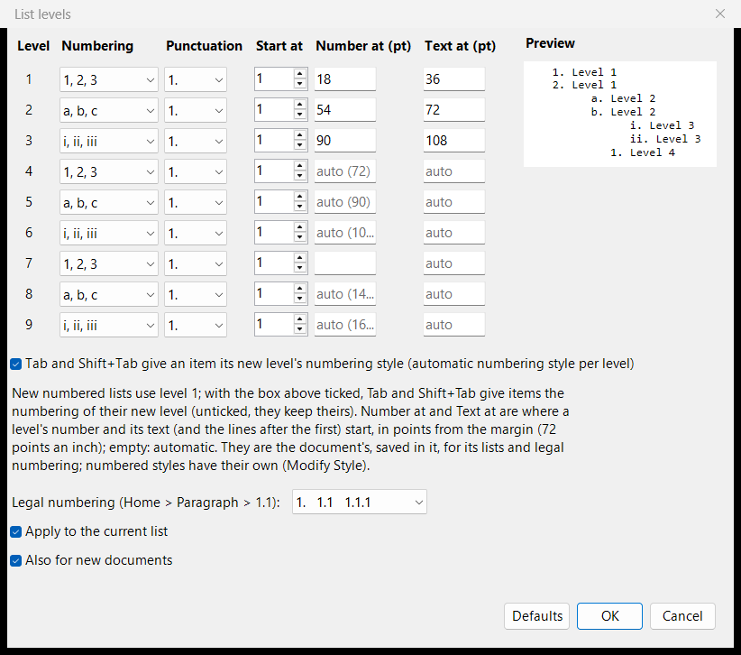
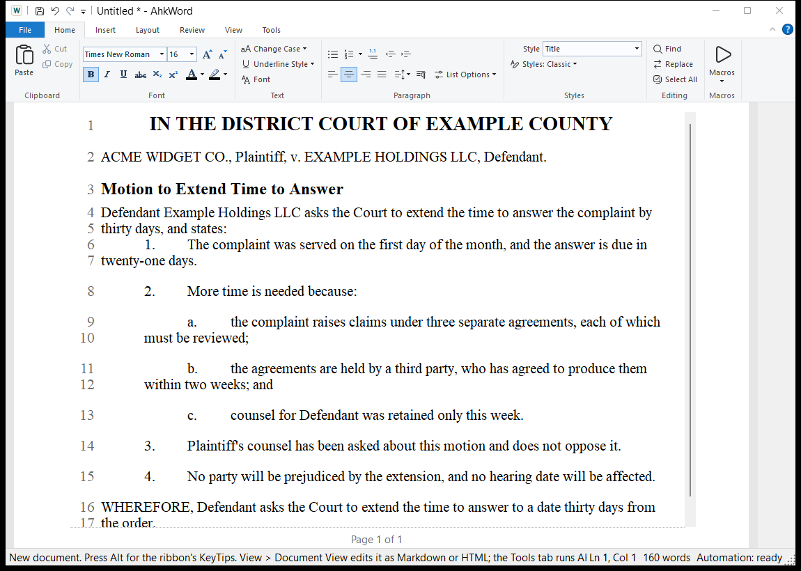

# Lists and numbering

AhkWord has three kinds of numbering, and they work together:

| Kind | Made with | For |
|---|---|---|
| **Lists** | the Bullets and Numbering buttons | bulleted and numbered lists in ordinary text |
| **Legal numbering** | the **1.1** button (Ctrl+Shift+G) | outlines numbered 1., 1.1, 1.1.1 |
| **Numbered styles** | a paragraph style with numbering, such as **Numbered Paragraph** | numbered paragraphs of court papers, motions and contracts |

## Lists

The **Bullets** and **Numbering** buttons in Home > Paragraph make the selected paragraphs a list (Ctrl+Shift+N: numbered). The arrow beside Numbering picks the style: 1, 2, 3; a, b, c; A, B, C; i, ii, iii; I, II, III.

- **Tab** and **Shift+Tab** move an item a level in or out.
- **Restart numbering** and **Continue numbering** (in the Numbering menu and List Options) start a list again at a number, or carry on from the list before.
- **No numbering** ends the lists of the selected paragraphs, whatever their numbering: the numbers go, the text stays.
- **Convert typed numbers to lists** (List Options) turns numbers typed by hand, as some documents from elsewhere have, into a real list.

## List levels

**List Levels...** (in the Numbering menu and in List Options) sets, for each of the nine levels:

- its **numbering** style and **punctuation** (1. 1) (1) 1), and its **start** number;
- **Number at** and **Text at**: where the level's number starts and where its text (and the lines after the first) start, in points from the margin (72 points to the inch), as Word's *number position* and *text indent*. Leave them empty for automatic: the number 18 points further in at each level, the text just after it.

Tick **Tab and Shift+Tab give an item its new level's numbering style** (on at first) for 1. / a. / i. as items move in; untick it and items keep their own style.

The levels belong to the document: they are saved in it, and in Word files as the lists' own levels, and a Word document you open brings its lists' indents. **Also for new documents** (ticked at first) makes them your levels for new documents too. **Apply to the current list** gives an existing list the new levels.

## Legal numbering

The **1.1** button (Ctrl+Shift+G) numbers the selected paragraphs 1., 1.1, 1.1.1 by level: Tab and Shift+Tab move an item a level in or out, and Enter, Backspace and Delete keep the numbers right. List Levels sets where each level's number and text start, and whether the numbers end in a period (1. 1.1 1.1.1, or 1. 1.1. 1.1.1., or none). Word and LibreOffice get real list numbering, which renumbers itself when the document is edited there.

## Numbered styles

A paragraph style can number its paragraphs: **Modify Style > Numbering** chooses the format ("1.", "(a)", "i.", "A." and the like, or legal "1.1") and the level, 1 to 9. The **Numbered Paragraph** style that comes with AhkWord numbers paragraphs 1., 2., 3., as court papers and motions do; a style numbered "(a)" at level 2 numbers the points under them.

Numbered styles are made so that **cutting and pasting never mangles the numbering**:

- **One numbering through the document.** All the numbered styles' paragraphs (and legal numbering's) are counted together, on over the paragraphs between them, such as headings and quotations. A lower level starts again at (a) under each item above it.
- **Numbers come from where each paragraph is.** Cut a numbered paragraph and the ones after it close up; paste it elsewhere and it **joins the numbering where it lands**, at its level, and everything after it renumbers. Undo takes back the paste and its numbers together. Numbered items pasted from Word join too.
- **It starts again only where you say:** List Options > Restart numbering, which is kept when the document is saved and opened again.
- **The number is part of the paragraph,** kept out of reach of typing: the caret goes after it.

### Sub-levels

**Tab** on a numbered paragraph makes it a point under the one before it (a., b. under 1.; i., ii. a level further in); **Shift+Tab** takes it back out. The sub-levels go 1. / a. / i. / (1) / (a) / (i) unless the style says otherwise: **Modify Style > Sub-levels** sets a style's own ("(a), (i)"), and **Sub-level indent** how much further in each sub-level is (36 points at first). The style's own indents (*Indent left*, *First line*) set where its numbers and lines start.

**Space between sub-levels** sets how a style's *space after* goes with its sub-levels: **None** (at first) keeps a paragraph and its points together, with no space after the paragraph or between its points, and the style's space after the last point; **After the paragraph above them only** leaves the space after the paragraph but none between its points; **After each** gives every paragraph the style's space after. A paragraph whose space after you set yourself (Paragraph dialog) keeps it.

Tab at the start of a numbered style's paragraph whose numbering is off (see below) makes it a sub-level item too, and removes a letter typed in front of it ("a. "). So does Tab over several such paragraphs selected together.

### Numbering off

**No numbering** on a numbered style's paragraph takes its number away and leaves its style, as Word's "numbering off" does: an unnumbered paragraph inside a run of numbered ones. It stays unnumbered, with its own indents, when you give it another style and then its style again (through Normal or a heading too, and when the document is saved in between). Numbering it again (the Numbering button, or Tab) takes that away.

### Numbered styles and Word

A Word document's numbered style (such as its *List Number*) comes in as a numbered style, numbered as Word numbers it, its sub-items as sub-levels. Word, LibreOffice and the built-in converter get real Word list numbering back, each level its format, with the style's indents. Giving a paragraph another style takes its number away; turning a style's numbering off takes its paragraphs' numbers away.

## Cross-references

**Insert > Cross-reference** refers to a numbered paragraph: "see paragraph 3(b)". Choose the paragraph, and whether to show **its number** ("(b)") or **its full number**, with the levels above it ("3(b)"); a trailing period is left out ("1." is "1"), and a lettered or roman sub-level is written in parentheses, as citations have it ("23(e)", "5(a)(iii)"). It works with legal numbering, numbered styles and numbered lists, and with sub-points typed in front of the paragraphs after a numbered one ("e. " at the start of the text): those are offered under their paragraph, as "23(e)".

The number follows the paragraph's: when paragraphs are added, moved or renumbered, the references change with them (in the same undo step). References to an ordinary numbered list's items are brought up to date before saving, printing and exporting, and with **F9** (**Insert > Update**). **Ctrl+click** a reference to go to its paragraph. If the paragraph it referred to is deleted, the reference says "(reference not found)".

References are kept in every format: Word and OpenDocument files get Word's own cross-references (bookmarks and REF fields), which Word and LibreOffice keep up to date too, and references made in Word come in as cross-references; HTML and Markdown get links to anchors. Scripts use `CrossReferenceTargets`, `InsertCrossReference` and `UpdateCrossReferences` (see the [API reference](../automation/api.md)).

## Footnotes

**Insert > Footnote** (Ctrl+Alt+F) puts a footnote at the caret: a superscript number in the text, and its note at the foot of the page. Footnotes are numbered 1, 2, 3 in order, and numbered again when one is added or taken out (F9 brings them up to date after you delete one with its text).

The notes are printed at the foot of their page under a short line, as in Word, and the page makes room for them; **View > Show Pages** shows them there on the sheets too. Elsewhere, hover over a footnote's number to see its note. **Ctrl+click** the number (or use Insert > Footnote with the caret on it) to change the note; an empty note takes the footnote out. A note can have more than one paragraph, as in Word: in the Footnote dialog, **Enter** starts a new paragraph and **Ctrl+Enter** is OK. Its words can be **bold**, *italic* and underlined (the B, I and U buttons in the dialog, or Ctrl+B, Ctrl+I and Ctrl+U there). The notes' size is the document's **Footnote Text** style's: set it in the Footnote dialog (*Size of all the notes*) or with Modify Style (its font too). A document without one has notes three quarters of its text's size (9 points for 12-point text); one opened from Word or LibreOffice keeps its notes' size, and gives it back to them when saved.

Word and OpenDocument files get real footnotes, and footnotes made in Word or LibreOffice come in as footnotes; HTML gets numbered links to a list of the notes at the end, and Markdown its footnote form (`[^1]` and `[^1]: the note`, its later paragraphs indented four spaces). The notes' paragraphs, bold, italic and underline go with them in every format; a line break in a Word note (Shift+Enter) comes in as a new paragraph. Scripts use `InsertFootnote`, `FootnoteText`, `FootnoteList`, `SetFootnote` and `DeleteFootnote`, with `` `n `` between a note's paragraphs and `<b>`, `<i>` and `<u>` tags for the formatting.
