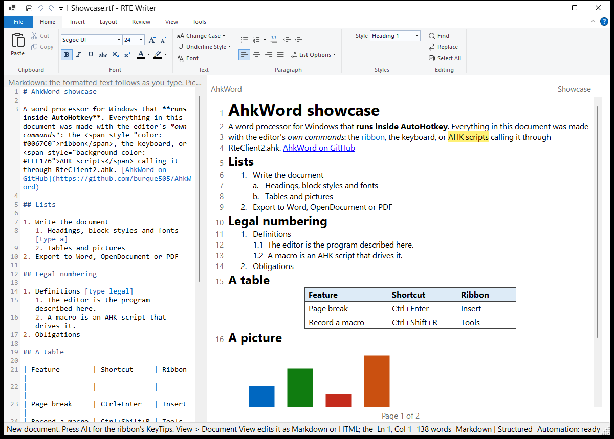

# Vistas Markdown y HTML

**Vista > Vista del documento** muestra el documento como **Markdown** o **HTML** en un editor de código, solo o **En paralelo** con el texto con formato, que lo sigue un momento después de que usted deja de escribir. Lo que edita en el texto con formato también se ve en el código. El editor de código tiene colores de sintaxis y números de línea (Vista > Números de línea del código los desactiva); Ctrl+rueda del mouse le aplica zoom.

- **Un editor de Markdown:** un archivo `.md` editado en la vista Markdown se guarda exactamente como lo escribió, con sus espacios, marcadores de lista y finales de línea. (Lo editado en la vista con formato se guarda como AhkWord escribe Markdown.)
- **Las teclas y los botones de formato insertan marcado:** Ctrl+B da `**negrita**` (`<strong>` en HTML), Ctrl+1 a Ctrl+6 títulos, los botones de lista `- ` y `1. ` (renumerados al aplicar sangría con Ctrl+M), las teclas de alineación `
`, el cuadro de fuente ``; Tabla, Vínculo, Imagen, Salto de página y Fecha y hora insertan los suyos. Los comandos que no tienen forma en Markdown o HTML lo dicen en la barra de estado.
- **Saltos de línea** (Mayús+Entrar) son ` ` en HTML, y `\` al final de la línea (o ` ` en títulos y celdas de tabla) en Markdown.
- **Las tablas quedan alineadas:** las tablas de Markdown se escriben con sus columnas alineadas. En la vista Markdown, Tab y Mayús+Tab en una tabla la vuelven a alinear y pasan de una celda a otra (Tab en la última celda agrega una fila), y el botón Tabla ordena la tabla en que está el cursor. Una línea en blanco, o una línea sin `|`, termina una tabla de Markdown.
- **El HTML se dispone de forma legible:** un párrafo o título por línea, con las listas y las tablas con sangría.
- **Las imágenes** se muestran en el código con nombres cortos (`embedded-1.png` ...) en lugar de sus datos.

Markdown no tiene formato de tablas (anchos, bordes, sombreado), interlineado ni espacio entre párrafos, así que un archivo `.md` los pierde; RTF, Word, OpenDocument y HTML los conservan. Una fila de tabla de Markdown es una sola línea, así que las tablas cuyas celdas contienen párrafos enteros se editan mejor en la vista con formato.

!!! tip "Desde un script"
    `Rte.View := "Markdown"`, `Rte.SideBySide := 1`, `Rte.SourceText`.
