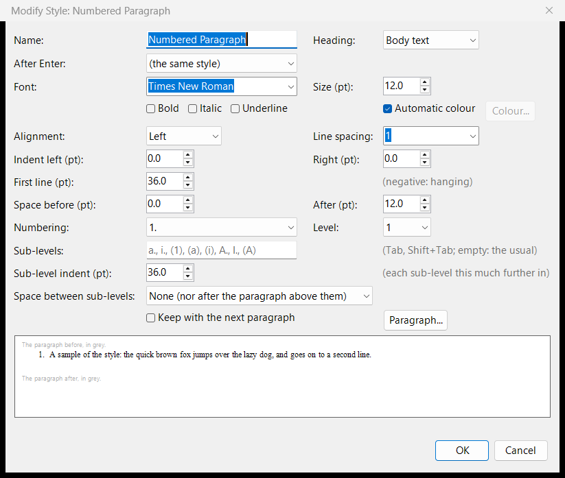
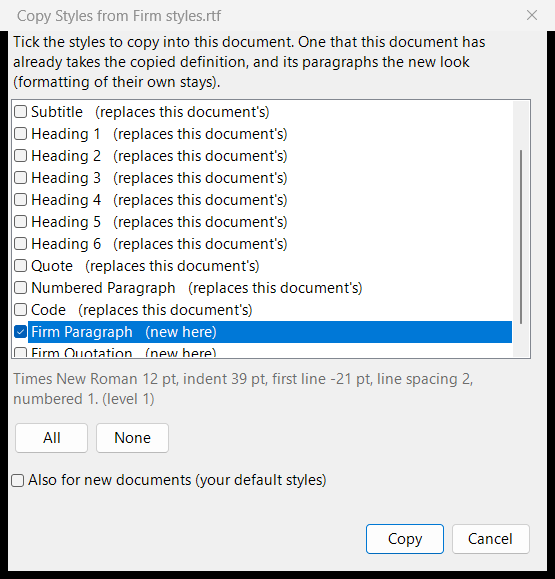

# Estilos

Cada párrafo tiene un **estilo**: Normal, Title, Subtitle, Heading 1 a Heading 6, Quote, Code, Numbered Paragraph y los suyos propios (los estilos que trae AhkWord conservan su nombre en inglés, también con la interfaz en español). Un estilo es un conjunto de formato (fuente, tamaño, color, alineación, sangrías, espaciado, interlineado, las reglas de saltos de línea y de página, y la numeración) que comparten sus párrafos. Cambie el estilo, y todos sus párrafos cambian con él.

## Elegir un estilo { #choosing-a-style }

Elija un estilo en el cuadro **Estilo** de la pestaña Inicio, o presione Ctrl+0 para Normal, Ctrl+1 a Ctrl+6 para los títulos y Ctrl+7 para Code. Los títulos son lo que dice su estilo: forman el esquema, los títulos `#` de Markdown y los `<h1>` a `<h6>` de HTML.

## Cambiar y crear estilos { #changing-and-making-styles }

**Inicio > Estilos** tiene:

- **Modificar estilo:** cambia la fuente, el tamaño, el color, la alineación, las sangrías, el espaciado, el interlineado, los saltos de línea y de página, el nivel de título, la numeración de un estilo, y el estilo que le sigue al presionar Entrar. Su botón **Párrafo...** abre el [cuadro de diálogo Párrafo](formatting.md#the-paragraph-dialog) completo.
- **Nuevo estilo:** un estilo nuevo a partir de un párrafo al que usted ha dado formato.
- **Actualizar estilo para que coincida:** hace un estilo igual a un párrafo al que usted ha dado formato.
- **Eliminar estilo:** quita un estilo propio; sus párrafos pasan a Normal.

Cuando un estilo cambia, sus párrafos conservan su formato propio (una palabra en negrita, por ejemplo), como en Word.

Copiar y pegar conserva los estilos de los párrafos, también entre ventanas de AhkWord.

## Conjuntos de estilos { #style-sets }

AhkWord trae tres conjuntos de estilos, ninguno de ellos de Word:

| Conjunto | Aspecto |
|---|---|
| **Clásico** (*Classic*, el predeterminado) | Times New Roman 12, títulos en negro: escritos judiciales, contratos, cartas |
| **Sencillo** (*Plain*) | Segoe UI 11, títulos en negrita |
| **Moderno** (*Modern*) | texto en Georgia con títulos en Segoe UI gris oscuro |

La lista desplegable Estilos muestra el conjunto del documento, por su nombre en inglés ("Estilos: Classic"), con "(cambiados)" cuando sus estilos difieren de los del conjunto.

## Sus propios estilos para cada documento nuevo { #your-own-styles-for-every-new-document }

- **Guardar estilos como predeterminados** da a los documentos nuevos los estilos de este documento, con sus cambios.
- **Copiar estilos de un documento...** trae a este documento los estilos que elija de otro: marque en la lista los que quiere (cada uno dice si es nuevo aquí o reemplaza uno que ya tiene), y marque **También para documentos nuevos** para agregarlos además a sus estilos de los documentos nuevos, sin que cambien los demás. Lee los archivos RTF y HTML propios de AhkWord (un estilo numerado viene con su numeración y sus subniveles), los archivos `.docx` de Word (los estilos numerados de Word, como *List Number*, vienen numerados) y otros archivos RTF.

!!! example "El estilo de párrafo de un despacho o un juzgado para todos sus documentos nuevos"
    Abra un documento nuevo, elija **Inicio > Estilos > Copiar estilos de un documento...**, elija un documento que tenga el estilo (por ejemplo *Párrafo del despacho*), marque solo ese estilo y **También para documentos nuevos**, y presione Copiar. Desde entonces todos los documentos nuevos lo tienen.

## Documentos de otras procedencias { #documents-from-elsewhere }

Un documento que abre conserva su propio aspecto: sus estilos se definen a partir del archivo, y la lista desplegable Estilos dice "Estilos: los del documento". **Aplicar mis estilos** le da en su lugar sus estilos (los que reciben los documentos nuevos), y conserva su formato propio.

Los estilos, con sus definiciones completas, se conservan en los archivos RTF, HTML, Word y OpenDocument, sea cual sea el convertidor que los escriba o los lea, de modo que un documento vuelve tal como estaba.

## Tabla de contenido { #table-of-contents }

**Insertar > Tabla de contenido** pone una tabla de contenido en el párrafo del cursor (en su lugar si está vacío; si no, antes de él), como la de Word: los títulos de los niveles 1 a 3 (Heading 1 a Heading 3), cada uno con la sangría de su nivel, con la página en la que se imprime en el margen derecho tras una fila de puntos, bajo un título, *Contenido*. El cuadro de diálogo elige:

- **Mostrar niveles**: los títulos que incluye, de 1 a 6;
- **Mostrar números de página**, y **Alinear números de página a la derecha** (si no, cada uno justo después de su título);
- el **carácter de relleno** antes de ellos: puntos, guiones, una línea o ninguno;
- el **título** ("Contenido" al principio; vacío: ninguno), en el estilo *TOC Heading*.

Las entradas están en los estilos *TOC 1* a *TOC 6* (se crean al insertar la primera tabla, como en Word), que Modificar estilo cambia como cualquier otro.

La tabla no sigue sola a los títulos, como en Word: **F9** (Insertar > Actualizar), o clic derecho en ella > **Actualizar tabla**, la rehace a partir de los títulos tal como están; **Actualizar solo los números de página** conserva sus entradas y pone al día sus páginas. Los números de página, por sí solos, se ponen al día antes de guardar, imprimir y exportar, y al abrir un documento. **Ctrl+clic** en una entrada va a su título. Insertar > Tabla de contenido con el cursor en una tabla de contenido cambia las opciones de esa tabla.

Las tablas de contenido se conservan en todos los formatos: los archivos de Word y OpenDocument reciben la propia tabla de contenido de Word (un campo TOC, con sus entradas vinculadas a marcadores en los títulos y sus páginas como campos PAGEREF), que Word y LibreOffice pueden actualizar por sí mismos, y una tabla de contenido hecha en Word o LibreOffice entra como tal; HTML y Markdown reciben vínculos a los títulos. Los scripts usan `InsertTableOfContents`, `UpdateTableOfContents` y `TableOfContents` (vea la [referencia de la API](../automation/api.md), en inglés).
