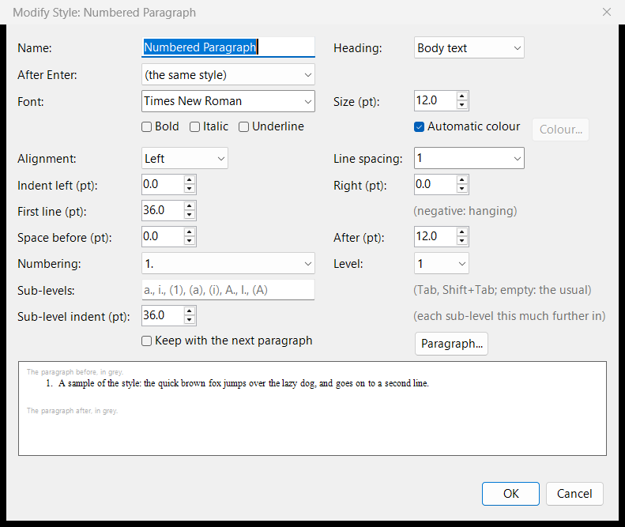
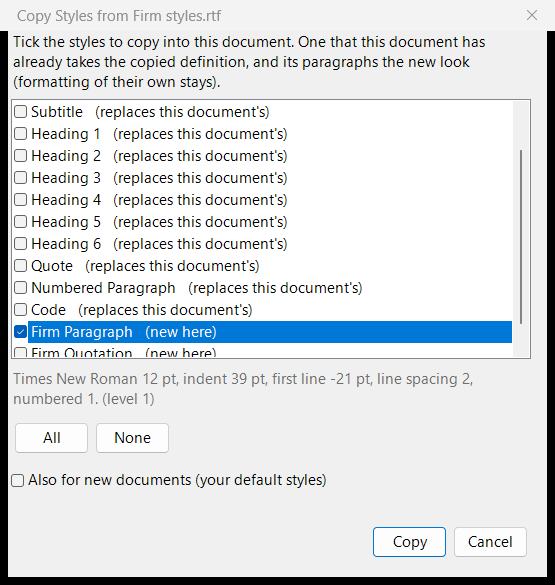

# Styles

Every paragraph has a **style**: Normal, Title, Subtitle, Heading 1 to 6, Quote, Code, Numbered Paragraph, and your own. A style is a set of formatting (font, size, colour, alignment, indents, spacing, line spacing, the line and page break rules, and numbering) that its paragraphs share. Change the style, and all its paragraphs change with it.

## Choosing a style

Pick a style in the **Style** box on the Home tab, or press Ctrl+0 for Normal, Ctrl+1 to Ctrl+6 for the headings and Ctrl+7 for Code. Headings are what their style says: they make the outline, Markdown's `#` headings and HTML's `<h1>` to `<h6>`.

## Changing and making styles

**Home > Styles** has:

- **Modify Style:** change a style's font, size, colour, alignment, indents, spacing, line spacing, line and page breaks, heading level, numbering, and the style that follows it when you press Enter. Its **Paragraph...** button opens the full [Paragraph dialog](formatting.md#the-paragraph-dialog).
- **New Style:** a new style from a paragraph you have formatted.
- **Update Style to Match:** make a style like a paragraph you have formatted.
- **Delete Style:** remove a style of your own; its paragraphs become Normal.

When a style changes, its paragraphs keep the formatting of their own (a bold word, for instance), as in Word.

Copy and paste keep paragraphs' styles, also between AhkWord windows.

## Style sets

Three style sets come with AhkWord, none of them Word's:

| Set | Look |
|---|---|
| **Classic** (the default) | Times New Roman 12, black headings: court papers, contracts, letters |
| **Plain** | Segoe UI 11, bold headings |
| **Modern** | Georgia text with Segoe UI headings in dark grey |

The Styles drop-down shows the document's set ("Styles: Classic"), with "(changed)" once its styles differ from the set's.

## Your own styles for every new document

- **Save Styles as My Default** gives new documents this document's styles, your changes included.
- **Copy Styles from Document...** brings chosen styles from another document into this one: tick the ones you want in the list (each says whether it is new here or replaces one you have), and tick **Also for new documents** to add them to your styles for new documents as well, your other styles staying as they are. It reads AhkWord's own RTF and HTML files (a numbered style comes with its numbering and sub-levels), Word's `.docx` files (Word's numbered styles, such as *List Number*, come numbered) and other RTF files.

!!! example "A firm's or court's paragraph style for all your new documents"
    Open a new document, choose **Home > Styles > Copy Styles from Document...**, pick a document that has the style (say *Law Paragraph*), tick only that style and **Also for new documents**, and press Copy. Every new document has it from then on.

## Documents from elsewhere

A document you open keeps its own look: its styles are defined from the file, and the Styles drop-down reads "Styles: The document's". **Apply My Styles** gives it your styles instead (the ones new documents get), keeping the formatting of its own.

Styles, with their whole definitions, are kept in RTF, HTML, Word and OpenDocument files, whichever converter writes or reads them, so a document comes back as it was.

## Table of contents

**Insert > Table of Contents** puts a table of contents at the caret's paragraph (in its place if it is empty, else before it), as Word's: the headings of levels 1 to 3 (Heading 1 to Heading 3), each indented by its level, with the page it is printed on at the right margin after a row of dots, under a title, *Contents*. The dialog chooses:

- **Show levels**: the headings it takes, 1 to 6;
- **Show page numbers**, and **Right-align page numbers** (else each just after its heading);
- the **tab leader** before them: dots, dashes, a line, or none;
- the **title** ("Contents" at first; empty: none), in the style *TOC Heading*.

The entries are in the styles *TOC 1* to *TOC 6* (made when the first table is inserted, as Word's), which Modify Style changes like any other.

The table doesn't follow the headings by itself, as in Word: **F9** (Insert > Update), or right-click it > **Update table**, makes it again from the headings as they are; **Update page numbers only** keeps its entries and brings their pages up to date. The page numbers alone are brought up to date before saving, printing and exporting, and when a document is opened. **Ctrl+click** an entry to go to its heading. Insert > Table of Contents with the caret in a table changes that table's options.

Tables of contents are kept in every format: Word and OpenDocument files get Word's own table of contents (a TOC field, its entries linked to bookmarks at the headings, their pages PAGEREF fields), which Word and LibreOffice can update themselves, and a table of contents made in Word or LibreOffice comes in as one; HTML and Markdown get links to the headings. Scripts use `InsertTableOfContents`, `UpdateTableOfContents` and `TableOfContents` (see the [API reference](../automation/api.md)).