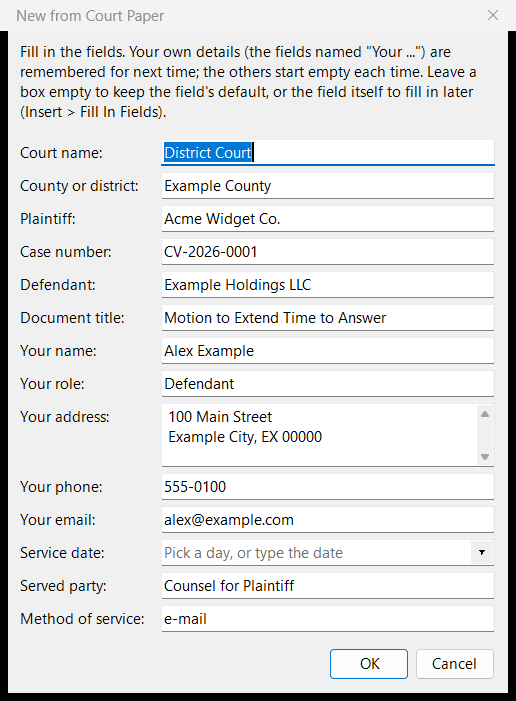

# Plantillas

## Usar una plantilla { #using-a-template }

**Archivo > Nuevo desde plantilla** crea un documento nuevo a partir de una plantilla: **Letter** (carta), **Memo** (memorando), **Report** (informe), **Court Paper** (escrito judicial, con una constancia de notificación), **Meeting Notes** (notas de reunión), o una propia. Las plantillas que trae AhkWord están en inglés. Un cuadro de diálogo pide sus campos, como los nombres de las partes; sus propios datos (`{{Your name}}` y similares) se recuerdan para la próxima vez, y los campos de fecha tienen un calendario.

- **Insertar > Insertar desde plantilla** pone el contenido de una plantilla en el documento que está escribiendo. Las partes **Caption** (encabezamiento), **Signature Block** (bloque de firma) y **Certificate of Service** (constancia de notificación) están hechas para eso.
- **Insertar > Rellenar campos** rellena los campos que quedan en un documento.

## Crear una plantilla { #making-a-template }

Una plantilla es un documento corriente con espacios en blanco.

1. **Empiece por un documento real** con la disposición que quiere (un escrito que haya presentado, una carta que haya enviado), o por uno en blanco. Todo lo que AhkWord conserva (fuentes, espaciado, tabulaciones, sangrías, tablas, encabezado y pie de página, números de línea), la plantilla lo conserva.
2. **Reemplace cada parte que cambia por un campo**, escrito en el texto:

    | Escriba | El cuadro de diálogo muestra |
    |---|---|
    | `{{Demandante}}` | un cuadro con la etiqueta "Demandante" (el nombre es la etiqueta) |
    | `{{Your role\|Demandante}}` | el cuadro, con "Demandante" si se deja vacío |
    | `{{Your address}}` | un cuadro de varias líneas (cualquier nombre que contenga "address", "dirección" o "domicilio"); cada línea pasa a ser un párrafo |
    | `{{Hearing date}}`, `{{Date}}` | el cuadro con un calendario al lado (cualquier nombre que contenga la palabra "date" o "fecha"): elija un día, o escriba la fecha como debe leerse ("el 3 de junio o hacia esa fecha") |

    - El mismo nombre usado varias veces se pide una sola vez.
    - Los campos cuyos nombres empiezan por "Your", "Su" o "Mi" (`{{Su nombre}}`, `{{Mi dirección}}`) se recuerdan: su nombre, dirección, teléfono y correo electrónico se rellenan solos la próxima vez (*Olvidar los valores recordados*, en el cuadro de diálogo, los borra). Los demás (las partes, el caso) se piden de nuevo cada vez.
    - El texto rellenado toma el formato del primer carácter del campo: dé a todo el `{{...}}` el aspecto que debe tener el texto.
    - Use corchetes para el texto que se escribirá a mano, como `[El primer punto.]`.

    AhkWord reconoce en los nombres de los campos tanto las palabras inglesas ("Your", "address", "date") como las españolas ("Su", "Mi", "dirección", "domicilio", "fecha"), con la interfaz en cualquier idioma.

3. **Guárdela como Texto RTF en su carpeta de plantillas** (`%APPDATA%\AhkWord\Templates`; *Su carpeta de plantillas*, en la página de inicio, la abre), con el nombre que debe tener la plantilla. Una pieza para insertar en otros documentos, como un encabezamiento o un bloque de firma, va en cambio en la carpeta `Parts` que hay dentro.
4. **Úsela** con Archivo > Nuevo desde plantilla, o con Insertar > Insertar desde plantilla para una parte. Para cambiarla más tarde, abra el propio archivo con Archivo > Abrir, edítelo y guárdelo.

Los campos del encabezado y del pie de página no se rellenan: tienen sus propios campos, como `{page}` (vea [Páginas e impresión](pages.md#headers-and-footers)).

Una plantilla también puede ser un archivo de Word (`.docx`), OpenDocument, Markdown, HTML o de texto; Texto RTF conserva todo lo que AhkWord puede hacer, así que es la mejor elección para las plantillas que usted crea en AhkWord.

## Adaptar las plantillas incluidas { #adapting-the-built-in-templates }

Las plantillas que trae AhkWord son puntos de partida, hechos para cambiarse. **Court Paper** en particular es genérica: los tribunales difieren en sus encabezamientos, márgenes, numeración de líneas, bloques de firma y constancias de notificación, y la incluida no sigue las normas de ningún tribunal en particular. Adáptela a su tribunal (y compruébela con las normas locales de ese tribunal):

1. **Archivo > Abrir** la plantilla incluida: está en la carpeta `templates` junto a AhkWord (la carpeta `Parts` que hay dentro tiene Caption, Signature Block y Certificate of Service).
2. Cámbiela como lo exija su tribunal: la disposición y la redacción del encabezamiento, los márgenes (Disposición > Configurar página), los números de línea (Disposición > Números de línea), las fuentes y el espaciado, y los campos que pide.
3. **Guardar como** Texto RTF en **su** carpeta de plantillas (`%APPDATA%\AhkWord\Templates`, o su carpeta `Parts` para una parte), nunca sobre el archivo incluido:
    - **con el mismo nombre** ("Court Paper"), y se usa la suya en lugar de la incluida;
    - **con un nombre propio** ("Court Paper - Juzgado de Ejemplo"), y aparece junto a las demás: una para cada tribunal ante el que presente escritos.

Su carpeta de plantillas es suya: actualizar AhkWord reemplaza la carpeta del programa, con las plantillas incluidas, pero nunca toca las suyas. Para volver a una plantilla incluida, elimine o cambie el nombre de la suya.

!!! tip "Plantillas para un despacho"
    Un despacho puede guardar sus plantillas (una por tribunal, su membrete, sus contratos tipo) en una carpeta compartida, y copiarlas en la carpeta de plantillas de cada persona cuando cambian. Las plantillas propias y los datos recordados de cada persona siguen siendo suyos.

## Fragmentos { #snippets }

Un **fragmento** es una parte con una abreviatura: escriba la abreviatura en el documento, luego **Espacio**, **Entrar**, **Tab** o un signo de puntuación, y se convierte en la parte, con formato y pidiendo sus campos, como la inserta Insertar desde plantilla. Escriba `;firma` y un espacio, y ahí está su bloque de firma.

**Insertar > Fragmentos...** los enumera, y los crea y cambia:

- **Nuevo:** dele una abreviatura, y escriba o pegue (Ctrl+V) su texto en el cuadro, con formato mediante N, K, S y Fuente... Los campos como `{{Your Name}}` se piden al insertarlo. El texto se guarda como una parte, con el nombre de la abreviatura salvo que usted le dé otro.
- **Nuevo desde la selección:** lo mismo, con el texto seleccionado en el documento en el cuadro: un bloque de firma, una cláusula tipo, cualquier texto, con todo su formato.
- **Cambiar:** su abreviatura, cómo se activa y su texto, en el mismo cuadro. Elegir por su nombre una de sus partes (o una incluida) muestra su texto; cambiarlo allí cambia la parte.
- **Quitar** e **Insertar ahora**.

Cada fragmento elige cómo se **activa**:

- **Con un carácter final** (así al principio): Espacio, Entrar, Tab o puntuación después de la abreviatura. **Conservar el carácter final** lo deja después del fragmento; sin ella (así al principio), `;firma` y Entrar inserta el bloque sin una línea vacía después.
- **De inmediato,** en cuanto se escribe la abreviatura (el `*` de AutoHotkey).
- **Distinguir mayúsculas:** la abreviatura se activa solo escrita tal cual.

!!! tip "Abreviaturas que no son palabras"
    Una abreviatura que también es una palabra (`con`, `sin`, `re`) se activaría cada vez que escribiera la palabra: empiécela con un signo, como `;con`, `;firma`. El cuadro de diálogo avisa de las palabras comunes.

Los fragmentos son **hotstrings** de AutoHotkey, que `AhkWord.ahk` prepara para su propia ventana: funcionan en el documento de AhkWord (y, como texto sin formato, en las vistas Markdown y HTML), no en sus cuadros de diálogo ni en otros programas. Con varias ventanas de AhkWord abiertas, un fragmento se activa solo en la que usted escribe. Deshacer devuelve el fragmento a lo que escribió.

**En otros programas:** **Exportar como script** escribe los fragmentos como un pequeño script de AutoHotkey v2 de hotstrings de texto sin formato (sus campos con sus valores predeterminados, o `[sus nombres]`). Ejecútelo con AutoHotkey junto a sus propios scripts, y limítelo a algunos programas con `#HotIf` si lo desea. No necesita AhkWord.

Los fragmentos se guardan en `snippets.json` junto a sus propias plantillas (en la carpeta de AhkWord en el modo portátil), compartidos por todas las ventanas de AhkWord: uno creado en una ventana funciona también en las demás. Los scripts usan `Rte.Snippets`, `AddSnippet`, `RemoveSnippet`, `InsertSnippet`, `SaveSelectionAsSnippet` y `ExportSnippets` (vea la [referencia de la API](../automation/api.md), en inglés).
