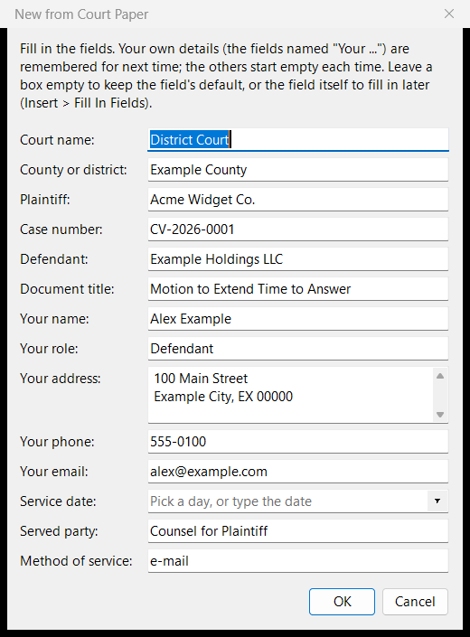

# Templates

## Using a template

**File > New from Template** makes a new document from a template: **Letter**, **Memo**, **Report**, **Court Paper** (with a certificate of service), **Meeting Notes**, or one of your own. A dialog asks for its fields, such as the parties' names; your own details (`{{Your name}}` and the like) are remembered for next time, and date fields get a calendar.

- **Insert > Insert from Template** puts a template's content into the document you are writing. The parts **Caption**, **Signature Block** and **Certificate of Service** are made for that.
- **Insert > Fill In Fields** fills in fields left in a document.

## Making a template

A template is an ordinary document with blanks.

1. **Start from a real document** with the layout you want (a paper you have filed, a letter you have sent), or from a blank one. Whatever AhkWord keeps (fonts, spacing, tabs, indents, tables, header and footer, line numbers), the template keeps.
2. **Replace each part that changes with a field**, typed into the text:

    | Type | The dialog shows |
    |---|---|
    | `{{Plaintiff}}` | a box labelled "Plaintiff" (the name is the label) |
    | `{{Your role\|Plaintiff}}` | the box, with "Plaintiff" filled in if it is left empty |
    | `{{Your address}}` | a box of several lines (any name with "address" in it); each line becomes a paragraph |
    | `{{Hearing date}}`, `{{Date}}` | the box with a calendar beside it (any name with "date" in it): pick a day, or type the date as it should read ("on or about June 3") |

    - The same name used several times is asked for once.
    - Fields whose names begin with "Your" are remembered: your name, address, phone and e-mail fill themselves in next time (the dialog's *Forget remembered values* clears them). Others (the parties, the case) are asked for fresh each time.
    - The filled-in text takes the formatting of the field's first character: format the whole `{{...}}` as the text should look.
    - Use square brackets for text to write by hand, such as `[The first point.]`.

3. **Save it as Rich Text Format into your Templates folder** (`%APPDATA%\AhkWord\Templates`; the start page's *Your templates folder* opens it), named as the template should be called. A piece to insert into other documents, such as a caption or a signature block, goes into the `Parts` folder inside it instead.
4. **Use it** with File > New from Template, or Insert > Insert from Template for a part. To change it later, open the file itself with File > Open, edit it and save it.

Fields in the header and footer are not filled in: they have fields of their own, such as `{page}` (see [Pages and printing](pages.md#headers-and-footers)).

A template can also be a Word (`.docx`), OpenDocument, Markdown, HTML or text file; Rich Text Format keeps everything AhkWord can do, so it is the best choice for templates you make in AhkWord.

## Adapting the built-in templates

The templates that come with AhkWord are starting points, made to be changed. **Court Paper** in particular is generic: courts differ in their captions, margins, line numbering, signature blocks and certificates of service, and the built-in one follows no particular court's rules. Make it your court's (and check it against that court's local rules):

1. **File > Open** the built-in template: it is in the `templates` folder beside AhkWord (the `Parts` folder inside it has the Caption, Signature Block and Certificate of Service).
2. Change it as your court requires: the caption's layout and wording, the margins (Layout > Page Setup), the line numbers (Layout > Line Numbers), the fonts and spacing, and the fields it asks for.
3. **Save As** Rich Text Format into **your** Templates folder (`%APPDATA%\AhkWord\Templates`, or its `Parts` folder for a part), never over the built-in file:
    - **under the same name** ("Court Paper"), and yours is used instead of the built-in one;
    - **under a name of its own** ("Court Paper - Example County District Court"), and it is listed beside the others: one for each court you file in.

Your Templates folder is yours: updating AhkWord replaces the program's folder, built-in templates included, but never touches your templates. To go back to a built-in template, delete or rename yours.

!!! tip "Templates for a firm"
    A firm can keep its templates (one per court, its letterhead, its standard agreements) in a shared folder, and copy them into each person's Templates folder when they change. Each person's own templates and remembered details stay their own.
