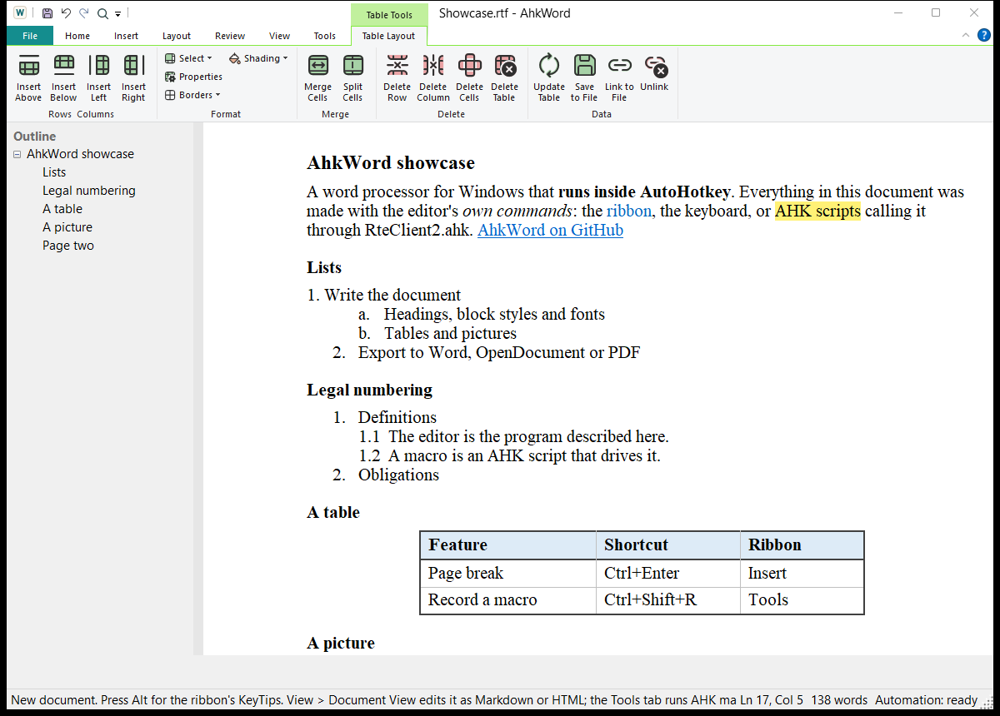

# AhkWord

{ width="96" align=right }

**AhkWord es un procesador de textos para Windows que los scripts de AutoHotkey pueden manejar mientras usted escribe.**

Tiene lo que pide la escritura de todos los días (estilos, listas, tablas, encabezados y pies de página, diseño de página, impresión y PDF), con especial cuidado por el trabajo de abogados y redactores de contratos: párrafos numerados que sobreviven a cortar y pegar, numeración legal, números de línea para escritos judiciales, plantillas de papel judicial, y documentos que van y vuelven de Microsoft Word sin perder su formato.

Y todo lo que hace puede hacerse desde un script de [AutoHotkey](https://www.autohotkey.com/): insertar texto, aplicar estilos, rellenar plantillas, reaccionar cuando se guarda el documento, o grabar sus propios pasos como una macro.

## Por dónde empezar

- **¿Es nuevo en AhkWord?** [Primeros pasos](getting-started.md) lo instala y abre su primer documento.
- **Escribir:** la [Guía del usuario](guide/documents.md) recorre los documentos, estilos, listas, tablas y páginas.
- **Abogados y redactores:** [Para la redacción jurídica](legal.md) reúne lo que más importa para escritos, demandas y contratos.
- **Scripts:** [Automatización](automation/index.md) muestra cómo los scripts controlan AhkWord, y la [Referencia de la API](automation/api.md) enumera todas las llamadas.

!!! note "En traducción"
    La interfaz de AhkWord está en español (**Revisar > Idioma > Español**). Esta documentación se está traduciendo: las páginas que todavía no tienen versión en español se muestran en inglés. La referencia de la API queda en inglés, como los nombres de las llamadas.

!!! note "Un trabajo en curso"
    AhkWord se construye por iteraciones, y esta documentación describe la última. Se llamó **RTE Writer** hasta la iteración 38: su primer inicio copia la configuración de RTE Writer, y los scripts escritos para RTE Writer siguen funcionando.

## De qué está hecho

AhkWord está escrito en C# y se ejecuta dentro de AutoHotkey v2. Su editor es [RichEditorNET](https://github.com/ellipticbit/RichEditorNET), un contenedor .NET del control RichEdit de Windows, y sus comandos están en la cinta de opciones de Windows (Windows Ribbon). [Csharp-in-AHK](https://github.com/burque505/Csharp-in-AHK) compila su código fuente al iniciarse, así que no hay paso de compilación. Es libre y de código abierto, con la licencia MIT, en [github.com/burque505/AhkWord](https://github.com/burque505/AhkWord).
