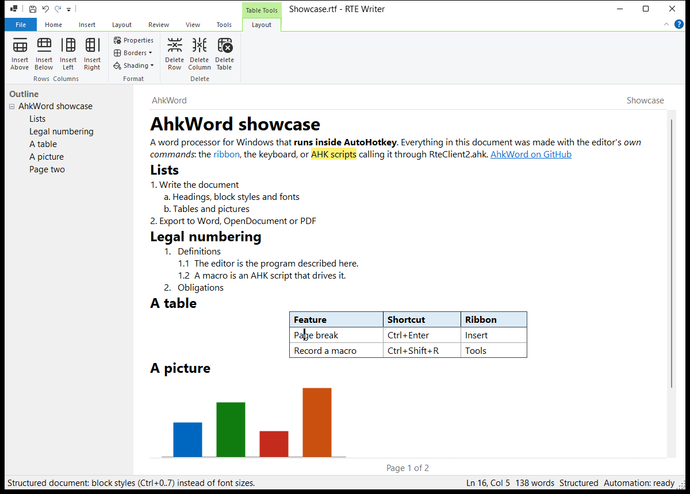

# AhkWord

{ width="96" align=right }

**AhkWord is a word processor for Windows that AutoHotkey scripts can drive while you type.**

It has what everyday writing needs (styles, lists, tables, headers and footers, page layout, printing and PDF), with particular care for the work of lawyers and contract drafters: numbered paragraphs that survive cutting and pasting, legal numbering, pleading line numbers, court-paper templates, and documents that go back and forth with Microsoft Word without losing their formatting.

And everything it does can be done from an [AutoHotkey](https://www.autohotkey.com/) script: insert text, apply styles, fill in templates, react to the document being saved, or record your own steps as a macro.

## Where to start

- **New to AhkWord?** [Getting started](getting-started.md) installs it and opens your first document.
- **Writing:** the [User guide](guide/documents.md) goes through documents, styles, lists, tables and pages.
- **Lawyers and drafters:** [For legal drafting](legal.md) gathers what matters most for pleadings, motions and contracts.
- **Scripting:** [Automation](automation/index.md) shows how scripts control AhkWord, and the [API reference](automation/api.md) lists every call.

!!! note "A work in progress"
    AhkWord is being built in iterations, and this documentation describes the latest. It was called **RTE Writer** until iteration 38: its first start copies RTE Writer's settings, and scripts written for RTE Writer keep working.

## What it is made of

AhkWord is written in C# and runs inside AutoHotkey v2. Its editor is [RichEditorNET](https://github.com/ellipticbit/RichEditorNET), a .NET wrapper of the Windows RichEdit control, and its commands are on the Windows Ribbon. [Csharp-in-AHK](https://github.com/burque505/Csharp-in-AHK) compiles its source when it starts, so there is no build step. It is free and open source, under the MIT license, at [github.com/burque505/AhkWord](https://github.com/burque505/AhkWord).
