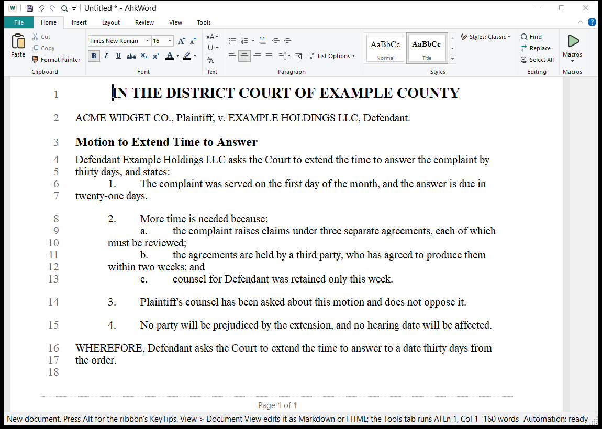

# Para la redacción jurídica

AhkWord se hizo pensando en abogados y redactores de contratos. Esta página reúne lo que más importa para demandas, escritos y contratos, con vínculos a los detalles.

## Párrafos numerados que sobreviven a cortar y pegar { #numbered-paragraphs-that-survive-cut-and-paste }

Los escritos judiciales y los contratos numeran sus párrafos, y los números deben seguir siendo correctos a medida que se mueven, agregan y eliminan párrafos. En AhkWord, la numeración pertenece al **estilo** del párrafo: dé a los párrafos el estilo **Numbered Paragraph** (o su propio estilo numerado) y quedan numerados 1., 2., 3.

- **Corte un párrafo** y los que le siguen se cierran; **péguelo** en otro lugar y se une a la numeración donde cae. Deshacer revierte el pegado y sus números a la vez.
- La numeración continúa por encima de los títulos y las citas que hay entre párrafos numerados, y vuelve a empezar solo donde usted lo indica.
- **Tab** convierte un párrafo en un punto bajo el anterior: (a), (b) bajo el 4.; Mayús+Tab lo saca de nuevo.
- **Sin numeración** deja sin numerar un párrafo del estilo, como una cita en bloque o una lista de elementos escritos como a., b., c., y sigue así cuando se cambian los estilos.

[Listas y numeración](guide/lists.md#numbered-styles) lo explica todo. Para esquemas numerados 1.1 y 1.1.1, use la [numeración legal](guide/lists.md#legal-numbering).

## Los estilos de su despacho o del tribunal { #your-firms-or-the-courts-styles }

Un despacho o un tribunal suele tener su propio estilo de párrafo: una sangría concreta, doble espacio, una numeración. Úselo en cada documento nuevo con **Inicio > Estilos > Copiar estilos de un documento**: elija un documento que tenga el estilo, márquelo y marque **También para documentos nuevos**. Vea [Estilos](guide/styles.md#your-own-styles-for-every-new-document).

## Papel con números de línea { #pleading-paper-line-numbers }

**Disposición > Números de línea** numera las líneas en el margen, de forma continua o reiniciando en cada página, cada línea o cada cinco, y omite los párrafos que usted elija. Los números son los de las líneas impresas, así que coinciden con el papel y con el PDF; `Rte.PrintedLineAt(position)` le indica a un script la página y la línea de un pasaje para citarlo. Vea [Line numbers](guide/line-numbers.md) (en inglés).

## Escritos judiciales desde plantillas { #court-papers-from-templates }

**Archivo > Nuevo desde plantilla > Court Paper** crea un escrito judicial con su encabezamiento y una constancia de notificación, y pregunta por el tribunal, el condado o distrito, las partes, el número de expediente y el título del escrito. **Insertar desde plantilla** agrega un encabezamiento (Caption), un bloque de firma (Signature Block) o una constancia de notificación (Certificate of Service) a un escrito que está redactando. Su propio nombre, dirección, teléfono y correo electrónico se recuerdan; los datos del caso se preguntan cada vez. Las plantillas que trae AhkWord están en inglés. Cree sus propias plantillas a partir de escritos que haya presentado: vea [Templates](guide/templates.md) (en inglés).

!!! warning "Adapte Court Paper a su tribunal"
    La plantilla Court Paper que trae AhkWord es un punto de partida genérico, no el formato que exige ningún tribunal. Los tribunales difieren en sus encabezamientos, márgenes, numeración de líneas, bloques de firma y constancias de notificación: adáptela a cada tribunal ante el que presente escritos, y compruébela con las normas locales de ese tribunal. [Adapting the built-in templates](guide/templates.md#adapting-the-built-in-templates) (en inglés) muestra cómo, con una plantilla para cada tribunal.

## Trabajar con Word { #working-with-word }

La parte contraria, los tribunales y los clientes usan Word. AhkWord abre y guarda archivos `.docx` con sus estilos, numeración, sangrías, espaciado, tablas, encabezados y pies de página, y números de línea, y Word numera los párrafos numerados de AhkWord como listas propias. Un escrito puede ir y venir sin que su formato se deshaga. Vea [File formats and converters](reference/formats.md) (en inglés).

## Anexos y presentación { #exhibits-and-filing }

- **Exportar como PDF** (pestaña Disposición) crea el PDF para presentar.
- La macro **PDF on save** crea un PDF junto al documento cada vez que se guarda, y **Folder to PDF** crea los PDF de toda una carpeta. Vea [Automation](automation/index.md#the-example-macros) (en inglés).
